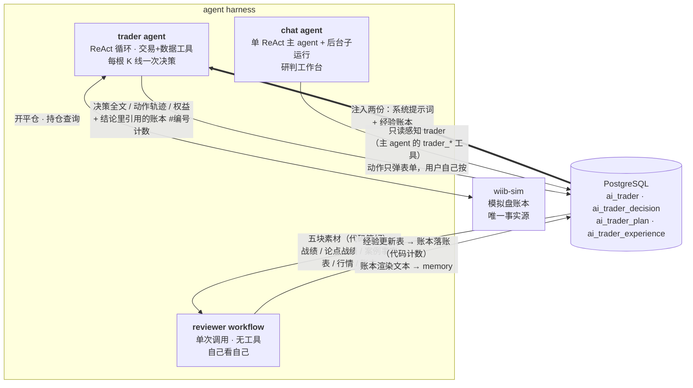
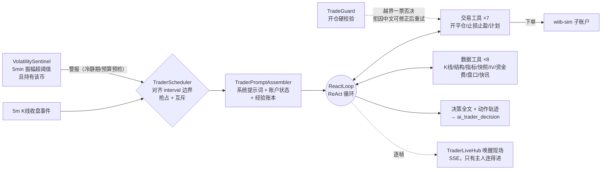
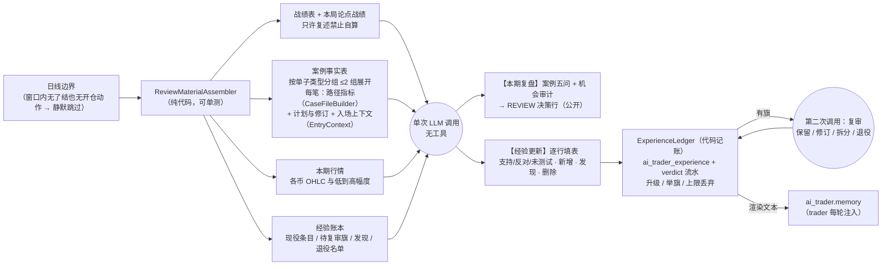
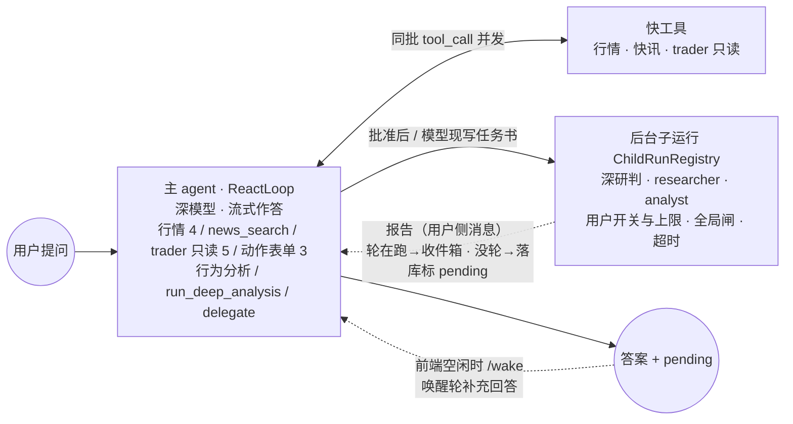
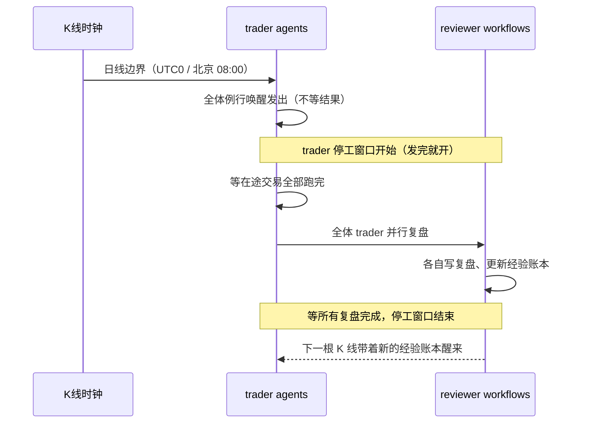

# Agent Harness 架构

这份文档讲平台里那套 LLM 装置：五处用法各自是什么形态、循环怎么停、彼此如何只经 PostgreSQL 咬合，以及每一处的设计取舍。视角是"这套东西是什么、为什么这么搭"。

配套的代码阅读指南见同目录 [tutorial.md](./tutorial.md)。

平台里有五处独立的 LLM 用法，形态和停止条件各不相同。它们之间不直接调用，只通过 PostgreSQL 交换数据，加一套新的不用改旧的。

叶子 agent 的 ReAct 循环是自写的 `ReactLoop`（Spring AI 2.0.1 原语：`ChatModel` 调模型、`ToolCallback` 执行工具、`Flux<ChatResponse>` 出流），不引图引擎。取舍原则是：能写死成代码的固定步骤就写死，只有开放决策才交给模型循环。五处里两处是真正的 agent（trader / chat），另外三处是一次性调用。

| 装置 | 形态 | 工具 | 循环 | 触发 | 模型来源 | 产出 |
|---|---|:---:|:---:|---|---|---|
| **trader agent** | ReAct 循环 | 15 | ✓ 上限 12 次调用 | 每根 K 线收盘 / 波动警报 | 主人的 key | 真实开平仓 + 决策行 |
| **reviewer workflow** | 单次调用（有待复审条目时再加一次） | 0 | ✗ | 日线边界 | 同 trader | 案例复盘 + 经验账本 |
| **chat agent** | 单 ReAct 主 agent + 后台子运行 | 16 | ✓ 上限 8 次调用（每个子运行各算各的） | 用户提问 | 用户的 key | 流式回答 |
| **replay coach** | 单次调用 | 0 | ✗ | 手动复盘里点「AI 提示 / AI 评估」 | 用户的 key | 盘面提示 / 整局操作评估 |
| **behavior workflow** | 单次调用 | 0 | ✗ | 对话里明说要分析自己（`analyze_my_behavior`） | 用户的 key（chat 那颗深模型） | 行为画像报告 |

模型来源：面向用户的四处（交易、对话、复盘教练、行为分析）全部 BYOK（用户自带 key，AES-GCM 加密存库），统一放在一个端点库里，按用途绑定。交易员一天自动跑几十上百轮要便宜稳，对话是按需的深度研判要强模型，所以允许各绑各的端点；只配一条时它就是全局默认。平台自己掏钱的只剩 news-translation（快讯英文译文）一个功能位，外加一个主位出错才调的可空备用位（`ai_runtime_config` + `ai_model_assignment`）——它是后台批量任务，没有"当前用户"可言。behavior 的平台功能位已退休，那次调用记在用户自己的 key 上。

behavior 不做成 agent 的原因：它那 7 个数据源的参数都是 `userId`、端点固定，模型没有决策空间，套 ReAct 循环只是多跑几趟，所以就是并发拉 7 个端点、拼一个 prompt、调一次 LLM。它也不挂 HITL 闸门：深研判一调就是 3 次深模型调用，这里只有 1 次，而"分析我的交易习惯"本身就是用户明说的意图，再弹卡请他确认自己刚说过的话是纯噪音；防滥调靠 30 分钟缓存与并发闸门。

## 全景：交易那三套如何经 DB 咬合

（`behavior` 不在这张图里，它读的是 wiib-sim 的用户行为数据，与交易这条链没有交集。）



trader 每次唤醒收到两份注入：平台系统提示词（环境 / 工具 / 规格 / 护栏，只讲事实，不带交易观点）、经验账本（自己复盘沉淀的规律与执行缺口，代码记账后渲染成文本），再加主人的交易指令（方法 / 风格 / 纪律的唯一来源，用户自己写，新建时预填平台默认那套）。几份并列不合并，来源分开模型才分得清哪条是自己的经验、哪条是主人定的。trader 只读这些文本，不关心是谁写的，以后再加一份新笔记也不用改 trader；结论里写了账本的 `#编号`，代码只做引用计数，不影响决策。

## trader agent：唯一会动真账本的



- 四道外部停止条件：单轮模型调用上限 12 次、唤醒预算（截止到下一根 K 线前 5 秒）、单轮 600 秒上限、连续 5 次失败自动暂停。都在模型之外，模型改不了。上限给到 12 是因为并不并行差得远：会并行的模型一轮发 4~9 个 tool_call，两三次就取完数；不并行的一轮一个，多币多周期求证根本走不完。保险丝还会在最后一次能执行工具时贴一句收尾提示，让模型下一次调用直接给结论——撞上限时末尾若是纯 tool_call，这轮就没有结论块，下一轮的检验旧论点和复盘素材都跟着缺。同一批 tool_call 里的数据工具并发执行；批里有动作工具就整批串行。
- 仓位规格（币种白名单 / 杠杆区间 / 保证金占比 / 同币杠杆一致 / 单仓模式 / 禁对冲）由 `TradeGuard` 校验，越界直接拒绝而不是截断：平台悄悄把数字改小，模型不知道，后面的止损计算全是错的。主人能选的币种上限是 3，这条在保存配置时就挡住（`TraderService.MAX_SYMBOLS`），与调用上限 12 是同一笔账——一个币扎实求证约 3 次。
- 开仓必须给论点标签、数据引用、失效条件，落 `ai_trader_plan`，每次唤醒原样注入。怎么退出由主人的交易指令定（平台预填的默认指令写的是止损、止盈、失效条件、主人留言四条路，可改可删）。计划归档不删，是 reviewer 的原料。
- BYOK：用户自带 key 与模型（AES-GCM 加密存库，baseUrl 走 SSRF 白名单校验）。

### 唤醒现场：过程只给主人，结论才公开

一次唤醒的过程逐帧推出来（`TraderLiveHub` 扇出，`WakeTrace` 记状态）：`run_start` → `prompt` → 每次模型调用的 `model_start` / `token…` / `model_end` → `tool_result…` → `run_end`。中途连上按当前状态回放，空闲只有心跳（20s 一帧，nginx 默认 60s 掐静默连接，留 3 倍余量；订阅 30 分钟到点前端重连）。同一份轨迹 `toJson` 落 `ai_trader_decision.trace_json`，事后能回看。

这条线的可见性与决策行是分开的两档：

| 面 | 谁能看 | 内容 |
|---|---|---|
| 竞技场排行 / 详情 / 决策时间线 / 净值曲线 | 登录即可 | 推理全文、开仓论点与修订史、复盘正文、经验账本 |
| 现场流 `/{id}/live` | 只有主人 | 逐字吐字、每次工具调用的入参与回执 |
| 落库轨迹 `/{id}/decisions/{decisionId}/trace` | 只有主人 | 同上，事后回放 |

决策日志天生公开——观赏性是产品核心；但工具入参回执是主人自己那套打法的底牌，公开的只到决策正文为止。两个接口的拒法不一样：`live` 直接抛非主人，`trace` 对非主人回 `null`——轨迹入口本就藏在主人才见得到的按钮后面，报错反倒把"有这东西"讲了出去。

## reviewer workflow：自己看自己

它不是 agent：没有工具、没有循环，一次调用进去出来（有待复审的条目时再调一次）。素材由代码算齐，模型只负责解读与填表，没有机会自己去挑一段对自己有利的行情；账本的计数、升级、举旗、退役全在代码里，模型只提议。



- 复盘的对象是单子类型的生命周期，不是单笔盈亏：亏单答"失败怎么界定 / 失败后怎么处理"，赢单答"判断还是运气 / 少赚了多少 / 可复制条件"，界定必须是可观察的价格、根数或时间。路径指标（最大浮盈 / 最大逆向 / 到目标 25%·50% 用时 / 首次收回入场价 / 出场后 4h·24h 最有利价）全由代码从本地 5m K 线算。
- 账本是结构化行而不是自由文本：条目分执行缺口 / 假设 / 规律 / 发现，带单子类型、格子（入场条件 … 执行缺口）、方向（机会型 / 限制型 / 执行型）。假设支持满 3 次（反对不超过支持的 1/3）升为规律；近 5 次反对 ≥3、反对追平支持且核对 ≥4、或连续 6 次未测试则举旗，由第二次调用复审，代码从不自动降级。上限：现役 10 条、同类 3 条、限制型 2 条；主人指令里已有的不许进账本。
- 限制型规律默认只供参考（`learned_restriction_hold` 关），避免 trader 学会"不交易"；主人可开。发现（"主人指令本身在花钱"）只给主人页看，不注入。
- 降级安全：经验更新一行都解析不出时 REVIEW 行照存、账本不动；复审失败只记文案、旗留到下期；复盘失败不计连败（没有资金风险）。旧的自由文本 memory 第一次复盘时压成账本行（一次迁移调用）。
- 主人页可钉住（不举旗）/ 退役 / 恢复 / 删除条目；重置开新局带入时现役条目复制到新局。

## chat agent：研判工作台

一轮只有一个 agent：主 agent 是一个 `ReactLoop`（深模型、流式），全部对话工具都挂在它身上，取什么数它自己定。`ChatTurnRunner` 里剩下的是几行直线 Java：挂收件箱 → 读历史 → 主 agent 跑 → 落库。长活不在轮里等：深研判、派出去的调研 / 行情分析都是后台子运行，报告回来再补答。



- 主 agent：16 个工具一张表，同一批 tool_call 并发执行；tool_choice 不强制（auto）：Opus 5.5 / Sonnet 5.5 / Fable 5.1 这类模型不收 any / required，"先取数再答"写在系统提示词里。以前的浅模型路由 + 专家叶子那一层没了：路由每轮要烧一次调用，而"要不要查行情"深模型顺手就判了。
- 子运行（`chat/run/`）：一套运行时管两类活，区别只在任务书是谁写的。`run_deep_analysis` 过了 HITL 闸门就 spawn 一个子运行、立刻返回 RUNNING；`delegate` 由主 agent 现写任务书、选 `researcher`（浅模型 + 快讯 + 服务端搜索）或 `analyst`（浅模型 + 行情 + 指标）预设，worker 看不到主对话、没有 delegate 也没有动作工具，深度只有一层。派发前三道检查：用户开关（只管 delegate，深研判是用户点过头的）→ 单用户在跑数（默认 3，可调到 5，按用户不按会话）→ 全局 `max-concurrent-children`；拒因原样回给模型，它自己做。
- 报告回灌只有一条规则：会话正挂着一轮就进收件箱，`ReactLoop` 下一次调模型前追加到尾部；没挂就在会话锁里直接追加进上下文并标 pending。报告是带【后台任务#…】标注的用户侧消息（裸 assistant 消息模型会当成"我自己说过的话"）；超时与失败也回灌一条失败报告，取消的不回灌。pending 随 done / status 下发，前端本地空闲时发 `/wake`，唤醒轮不落 user 行、答案带【补充回答】标头。/cancel、重新生成、删会话都连带停掉子运行。
- 名额：每用户同时一轮，占线直接拒（2203），前端把消息排在本地、这轮结束自动续发；子运行在名额之外（否则一个深研判占着名额几分钟），行情配额靠全局闸另保。
- trader 联动：主 agent 自己持有 trader 的只读工具（`trader_overview` / `trader_positions` / `trader_decisions` / `trader_plans` / `trader_trades`）；`wake_trader` / `review_trader_now` / `leave_note_to_trader` 只往对话里推一张表单（留言连草稿带轮次一起预填），按下按钮的是用户，模型碰不到执行路径；只有当场就烧钱的 `run_deep_analysis` 走 HITL 闸。
- 韧性：`ResilientChatService` 是叶子的模型调用层（系统提示、工具、搜索许可、重试）。流式路径带退避重试，仅在尚未吐帧时重订阅。不挂兜底模型：BYOK 只有一个端点，切到同端点的另一个模型没有意义。
- 横切：会话历史落 `workbench_chat_context` 自建表（终态整体覆盖写入），裸 JSON（`ChatContextCodec`，读兼容老的对象流格式）、调用限额 + 历史摘要压缩控预算。
- 新闻双源分工：主 agent 先调 `news_search` 拿 BlockBeats 清单，再用服务端搜索补充合并，独有条目带源标签；派出去的 researcher 同一套（它的搜索许可看浅模型那条端点）。搜索是端点显式勾选的能力，不是默认开着的——所以主 agent 的系统提示词按能力二选一拼：能搜就承诺联网补充，不能搜就如实说没有检索能力。提示词不许承诺端点给不了的事。
- 协议适配：四条协议——openai（chat/completions，走 Spring AI `OpenAiChatModel`）、responses、anthropic（Messages）、gemini（generateContent），后三条是自研 `ResponsesChatModel` / `AnthropicChatModel` / `GeminiChatModel`。挂工具的 options 由 `ToolOptions` 从模型自己的 options 派生；tool_choice 一律不传（auto），四条路行为一致。服务端搜索只有后三条声明得了，openai 的 chat-completions 没有标准的服务端搜索——所以"能不能搜"是协议能力与用户勾选的与。

### 模型来自用户，所以叶子也跟着用户走

```text
POST /api/ai/workbench/chat
  ├─ 解析端点（LlmEndpointService.chatEndpoints：CHAT_MAIN 绑定→默认端点） 一条都没有 → 2201，前端顶出配置弹窗
  ├─ 按指纹取/建主 agent 叶子（LRU 32） 建不出 → 2202，同上
  ├─ 并发闸门 tryAcquire          该用户已有一轮 → 2203 ／ 全局 10 满 → 2204
  └─ 这之后才 new SseEmitter
```

四道准入都在建流之前：一旦返回 `SseEmitter`，响应就是 `text/event-stream`，再报错只能推 error 事件，前端拿不到结构化错误码、没法自动引导去配置。

- 叶子按指纹缓存，userId 必须进指纹：指纹 = `SHA-256(userId + 主/轻两条端点各自的协议 / baseUrl / 模型 / 思考档位 / 搜索开关 / 密文)`（分量间拿 NUL 分隔——model 是用户自由输入，用空格的话 `("gpt-5 x","y")` 和 `("gpt-5","x y")` 会撞；NUL 是 Postgres 的 text 存不下的字节，绝不会出现在任何一个从库里读出来的值里）。搜索开关也是建模要素：它既进 `ResponsesChatModel` 的构造参数，也决定主 agent 提示词拼哪版，勾了必须换指纹。用户改配置指纹就变，自然拿到新叶子，不需要显式失效。userId 进指纹不是为了缓存粒度，是数据隔离：叶子里有按用户烤死的工具（主 agent 的 trader_* 工具读的是"这个人的 trader"，子运行按用户计上限），两人共用一份叶子就会看到别人的持仓；隔离要靠键本身，不能指望密文的随机性。
- 主模型 + 轻模型：主模型就是主 agent（作答、取数、深研判都是它）；轻模型（可选绑定 CHAT_LIGHT）跑历史压缩和派出去的 worker（researcher / analyst）。不绑就复用主模型实例本身，省一份客户端和连接池。
- 思考档位是端点属性，每条端点各自配；轻模型绑到别的端点就用那条自己的档位。**不设白名单**：`none/low/medium/high` 只是前端给的快捷选项，各家还有 `xhigh` / `minimal` 之类自己起的名，认不认只有上游知道，代码只抹平大小写空白、只挡列宽（VARCHAR(16)）。模型支不支持这个参数也查不到（OpenAI 标准 `/v1/models` 只回 id/object/created/owned_by），所以默认留空不传，由用户自己填，配套一个「测试连通性」按钮真发一次请求验——探测走的是生产建模路径，测什么就得是接下来真跑什么。
- 错误归类：401/403、429、404+model、超时 / 连不上各给一句能照着做的话；认不出来的不替用户判病因，因为那个 catch 罩着落历史、写记忆、上下文落库，数据库挂了也走这条路，兜底要是说"请检查端点与模型配置"，用户会去乱改一把本来没问题的 key。任何分支都不回显上游原文：中转网关的异常里经常带完整请求 URL（`?api_key=…`），正则追不全 key 的形态。

### HITL：判断要发生在信息完整的那一层

`run_deep_analysis` 一次烧三次深模型调用，必须用户点头。闸门不在工具内部，而是 `ApprovalGate` 实现 `ReactLoop.ToolGate`，循环执行工具前先问它：

```text
授权键 = (sessionId, 工具名, 归一化后的标的)
```

工具方法体看不到自己被调用时的 sessionId，而闸门拿得到 `ReactLoop.run` 传进来的会话号和待执行 tool_call 的名字与参数。所以卡片上写 BTCUSDT、模型改口要 ETHUSDT 时键不匹配，会重新弹卡。这不是多加一道校验，是把判断挪到了信息完整的那一层。

闸门放行后工具也不同步跑：起一个子运行立刻返回 RUNNING，裁决作为报告回灌，主 agent 被唤醒补答——用户不被一次几分钟的研判锁住。

## 日线边界的时序

一天一次的交接（`TraderScheduler.startDailyHandover`）：先交易，再全体复盘。复盘期间 trader 停工，因为它要读的是"已经定格的一天"，边写边读会读到半截数据。停工窗口挡住全部四个唤醒入口（例行 K 线 / 波动警报 / 手动唤醒 / 点播复盘），窗口内的 K 线事件直接丢弃不补跑。



窗口是**唤醒发出即开**，不等交易跑完——晚开的话 5m 档会在等待期间又醒一次占住 inFlight，那个 trader 的复盘就被跳过了。代价是窗口把阶段 0 的交易执行也圈了进去，时长上界变成唤醒 600s + 复盘 600s ≈ 20 分钟（两阶段各自内部全员并行，不设并发上限）。这是上界不是常态——跑完就关。5m 档 trader 最多丢 4 根 K 线、15m 档 1 根，日线交接每天只有一次，可接受。

chat 与 trader 的联动只到这一步：主 agent 的 trader_* 工具只读用户自己的 trader（概况与账本 / 持仓 / 决策行 / 计划 / 已了结交易），三个动作只弹表单，真执行走 trader 动作面板的 REST，chat 自己不碰 trader 本体。
