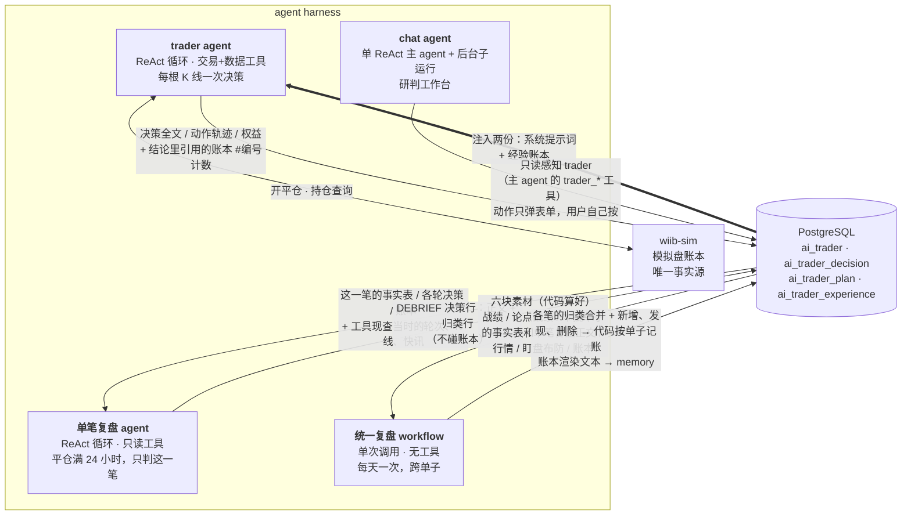
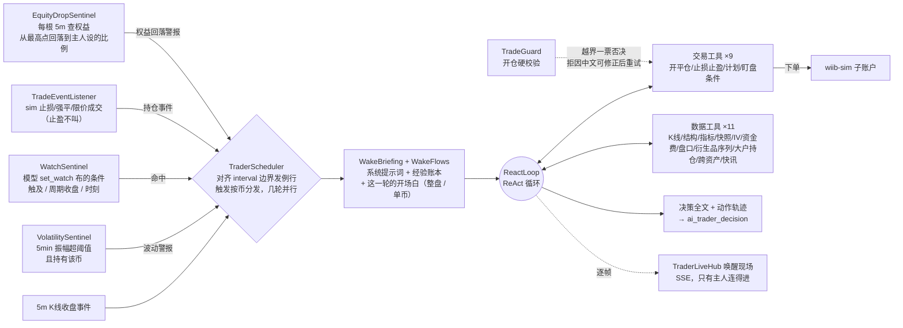
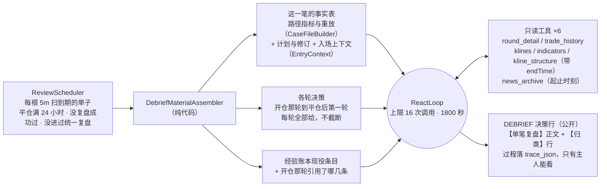
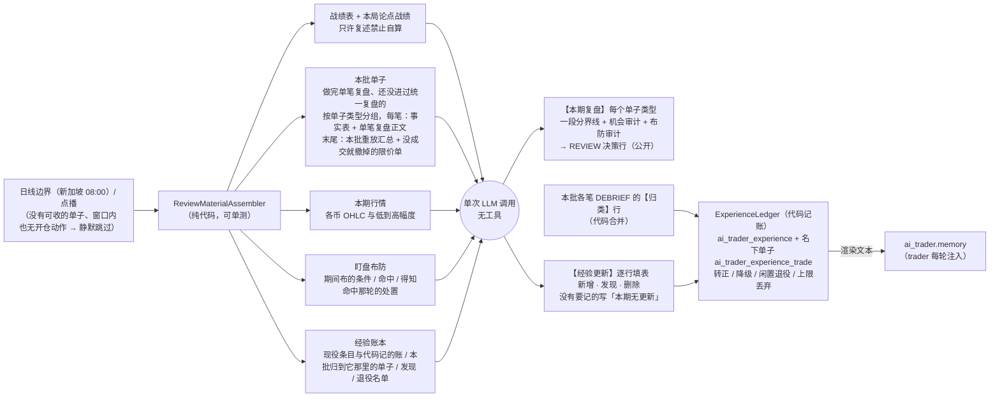
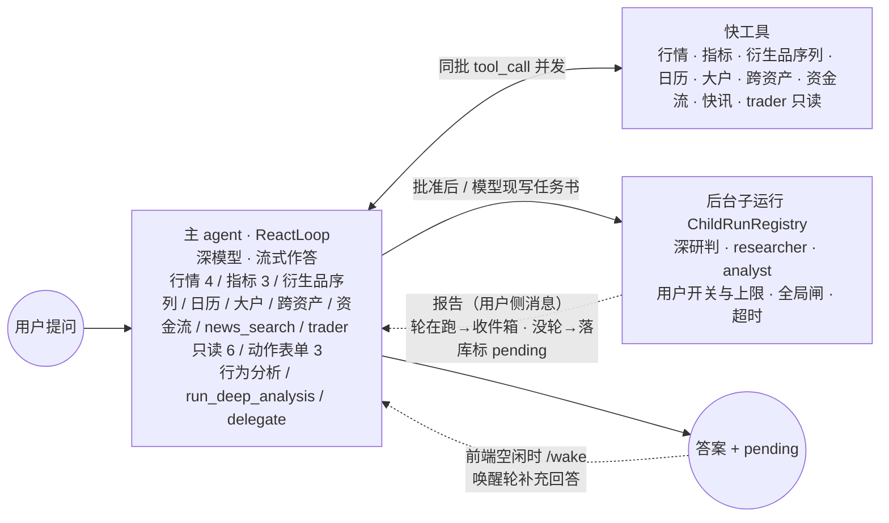
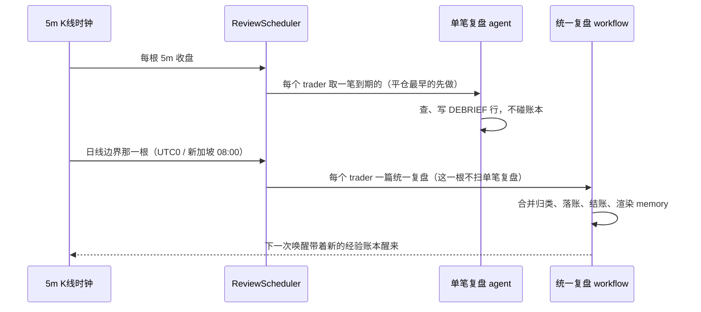

# Agent Harness 架构

这份文档讲平台里那套 LLM 装置：六处用法各自是什么形态、循环怎么停、彼此如何只经 PostgreSQL 咬合，以及每一处的设计取舍。视角是"这套东西是什么、为什么这么搭"。

配套的代码阅读指南见同目录 [tutorial.md](./tutorial.md)。

平台里有六处独立的 LLM 用法，形态和停止条件各不相同。它们之间不直接调用，只通过 PostgreSQL 交换数据，加一套新的不用改旧的。

叶子 agent 的 ReAct 循环是自写的 `ReactLoop`（Spring AI 2.1.0 原语：`ChatModel` 调模型、`ToolCallback` 执行工具、`Flux<ChatResponse>` 出流），不引图引擎。取舍原则是：能写死成代码的固定步骤就写死，只有开放决策才交给模型循环。六处里三处是真正的 agent（trader / 单笔复盘 / chat），另外三处是一次性调用。

| 装置 | 形态 | 工具 | 循环 | 触发 | 模型来源 | 产出 |
|---|---|:---:|:---:|---|---|---|
| **trader agent** | ReAct 循环，一轮管整盘或只管一个币，几轮可并行 | 20 | ✓ 上限 12 次调用（分两段时多 1 次收尾） | 每根 K 线收盘 / 盯盘条件命中 / 持仓事件 / 波动警报 / 权益回落警报 / 手动 | 主人的 key | 真实开平仓 + 决策行 |
| **单笔复盘 agent** | ReAct 循环 | 6（全只读） | ✓ 上限 16 次调用 | 单子平仓满 24 小时 | 同 trader | 这一笔的复盘正文 + 归到哪几条经验名下 |
| **统一复盘 workflow** | 单次调用 | 0 | ✗ | 日线边界（新加坡 08:00）/ 点播 | 同 trader | 跨单子的复盘 + 经验账本 |
| **chat agent** | 单 ReAct 主 agent + 后台子运行 | 25 | ✓ 上限 8 次调用（每个子运行各算各的） | 用户提问 | 用户的 key | 流式回答 |
| **replay coach** | 单次调用 | 0 | ✗ | 手动复盘里点「AI 提示 / AI 评估」 | 用户的 key | 盘面提示 / 整局操作评估 |
| **behavior workflow** | 单次调用 | 0 | ✗ | 对话里明说要分析自己（`analyze_my_behavior`） | 用户的 key（chat 那颗深模型） | 行为画像报告 |

模型来源：面向用户的四处（交易、对话、复盘教练、行为分析）全部 BYOK（用户自带 key，AES-GCM 加密存库），统一放在一个端点库里：对话按用途绑定，每个 trader 在自己的配置里选一条，没指定的都用默认端点。交易员一天自动跑几十上百轮要便宜稳，对话是按需的深度研判要强模型，所以允许各用各的端点；只配一条时它就是全局默认。平台自己掏钱的只剩 news-translation（快讯英文译文）一个功能位，外加一个主位出错才调的可空备用位（`ai_runtime_config` + `ai_model_assignment`）——它是后台批量任务，没有"当前用户"可言。behavior 的平台功能位已退休，那次调用记在用户自己的 key 上。

behavior 不做成 agent 的原因：它那 7 个数据源的参数都是 `userId`、端点固定，模型没有决策空间，套 ReAct 循环只是多跑几趟，所以就是并发拉 7 个端点、拼一个 prompt、调一次 LLM。它也不挂 HITL 闸门：深研判一调就是 3 次深模型调用，这里只有 1 次，而"分析我的交易习惯"本身就是用户明说的意图，再弹卡请他确认自己刚说过的话是纯噪音；防滥调靠 30 分钟缓存与并发闸门。

## 全景：交易那四套如何经 DB 咬合

（`behavior` 不在这张图里，它读的是 wiib-sim 的用户行为数据，与交易这条链没有交集。）



trader 每次唤醒收到两份注入：平台系统提示词（环境 / 工具 / 规格 / 护栏，只讲事实，不带交易观点）、经验账本（自己复盘沉淀、按名下单子的账转正的规律，和反复没做到的执行缺口，代码记账后渲染成文本），再加主人的交易指令（目标 / 边界 / 偏好，用户自己写，没写到的模型自己定，新建时预填平台默认那份）。几份并列不合并，来源分开模型才分得清哪条是自己的经验、哪条是主人定的。trader 只读这些文本，不关心是谁写的，以后再加一份新笔记也不用改 trader；结论里写了账本的 `#编号`，代码做引用计数，不影响决策；单笔复盘的素材里会点出开仓那轮引用了哪几条经验，不管单子是什么类型，由单笔复盘判：假设和规律，属于的记进名下，情况对不上的只记一次引用不符；执行缺口照样按守、破归。

一轮唤醒管多大范围分两种。整盘轮管全部可交易币：例行轮、手动轮、权益回落警报叫醒的轮，以及不归某一个币的事（全仓爆仓）叫醒的轮。单币轮只处理把它叫醒的那个币：盯盘命中、波动警报、限价单成交、止损或强平。系统提示词和工具清单所有轮共用一份，每一轮为什么醒、管哪些币、分几段走，都写在那一轮的开场白里。

整盘轮的开场白先窄后宽：第一段只念它自己留下的承诺——持仓与挂单的失效条件、布的每条盯盘条件离现价多远或还有多久、上一轮的等待行，代码逐条列事实——要它处置；答完才追加第二段（各币自上次唤醒以来的开高低收、快照、日历、战绩、轨迹）要它看整盘、布防、按固定格式收尾。没承诺要处置、没留言、也不是被触发叫醒的并成一段；开了联网的走三段（核查事实 → 要不要搜 → 交易与收尾），前两段不许开仓、加仓、反手。单币轮动作在前：第一段就能平仓、开仓、反手，开了联网的回头再查外部信息，最后给这个币布盯盘、写它自己那一段结论；开场白只带这个币的事实，外加一段只给数字的账户概况和一行 BTC 当大盘参考。几段都在同一个会话里，前面的往返后面都看得见。结论按币增量：每轮只写有变化的币，没写的币由代码带着它最近一次的那段进【上一轮结论】。

## trader agent：唯一会动真账本的



- 一个 trader 可以同时跑几轮：一轮整盘的，外加每个可交易币各一轮单币轮。一条触发先交给正在处理这个币的单币轮，没有就交给在跑的整盘轮，都没有新起一轮单币轮；交给在跑的轮就是插话——循环每次调模型前从收件箱取一次，作为一条新消息接在对话末尾，那一轮没读到就结束的另起一轮，不丢。例行到点时有整盘轮在跑就插进它，不另起第二轮整盘的；有单币轮在跑不影响，例行轮照常开始，不再被跳过。
- 几轮动的是同一个账户，靠两样东西保护。账户闸（`AccountGate`，每个 trader 一把）：下单、平仓、改止损、撤单、布盯盘、预案执行、开头的取账户加对账，一次只做一件。后动的先收到提示（`SeenAccount`）：每一轮记着它上次看到的每个币的持仓、挂单、盯盘条件，动手前拿现状比一下，变了这次不执行，先把变化告诉它，它重新提交才执行；开仓、加仓、反手还要比别的币的仓位。单币轮的交易和盯盘工具只认自己那个币，查行情的工具不限币。
- 盯盘条件多记一项"为哪个可交易币布的"（`ai_trader_watch.for_symbol`），命中时叫醒的是那个币的单币轮；对账出来的事件按币存（`ai_trader.unreported_events`），哪一轮管这个币就由哪一轮报，那一轮成功了才清。
- 权益回落警报（`EquityDropSentinel`）：主人设比例，不设不启用。每根 5m 收盘查一次权益，参照点是上次报警之后到过的最高点；回落到比例叫醒一轮整盘的，参照点从当时的权益重新记。平台只叫醒，不平仓，不限制开仓；被它叫醒的那一轮没跑成的，记一行，下一次整盘轮的开场白补报。两次例行轮之间只有单币轮在跑，没有哪一轮看整个账户，它补的是这一块。
- 四道外部停止条件：单轮模型调用上限 12 次、唤醒预算（截止到下一根 K 线前 5 秒）、单轮 900 秒上限、连续 5 次失败自动暂停。都在模型之外，模型改不了。上限给到 12 是因为并不并行差得远：会并行的模型一轮发 4~9 个 tool_call，两三次就取完数；不并行的一轮一个，多币多周期求证根本走不完。保险丝还会在最后一次能执行工具时贴一句收尾提示，让模型下一次调用直接给结论——撞上限时末尾若是纯 tool_call，这轮就没有结论块，下一轮的检验旧论点和复盘素材都跟着缺。分两段时第二段多占一次调用：第一段用到只剩最后一次或已用光，第二段照样追加、只许直接写结论，所以一轮最多 13 次。同一批 tool_call 里的数据工具并发执行；批里有动作工具就整批串行。
- 仓位规格（币种白名单 / 杠杆区间 / 保证金占比上限 / 同币杠杆一致 / 单仓模式 / 禁对冲）由 `TradeGuard` 校验，越界直接拒绝而不是截断：平台悄悄把数字改小，模型不知道，后面的止损计算全是错的。主人能选的币种上限是 3，这条在保存配置时就挡住（`TraderService.MAX_SYMBOLS`），与调用上限 12 是同一笔账——一个币扎实求证约 3 次。
- 开仓必须给论点标签、数据引用、失效条件，落 `ai_trader_plan`，每次唤醒原样注入。怎么退出由模型自己判断，主人的交易指令里有要求的按主人的。计划归档不删，是复盘的原料。
- 两次唤醒之间替它动手的只有它提前挂好的东西：sim 里的止损止盈单（止盈可以不设，也可以分最多 3 档）、预案（盯盘条件带一个动作，命中时 `PresetExecutor` 当场移止损 / 平仓 / 撤单，时间线记一行 PRESET）。这些都只会减风险，开新仓只有模型醒着自己下或它挂的限价单成交两条路；预案跑在 agent 进程里，进程重启那一两分钟不执行，止损单本身一直在 sim 里挂着。
- 视野不限于可交易币：开场白的行情快照和各币摘要都带一行 BTCUSDT（标成大盘参考），快照后面跟纳指期货 / 标普期货 / VIX；行情数据工具可查任意 Binance USDT 永续，盯盘条件能布在平台在采的任何币上；主人开了联网搜索（`ai_trader.web_search_enabled`）、所用端点也开了的另挂 `web_search`。平台给的都是原始读数——`market_snapshot` 不打分、不贴行情标签，账户块里的浮盈几 R、止损打掉亏权益百分之几也只是算好的事实，判断留给模型。
- BYOK：用户自带 key 与模型（AES-GCM 加密存库，baseUrl 走 SSRF 白名单校验）。

### 唤醒现场：过程只给主人，结论才公开

一次唤醒的过程逐帧推出来（`TraderLiveHub` 扇出，`WakeTrace` 记状态）：`run_start` → `prompt` → 每次模型调用的 `model_start` / `token…` / `model_end` → `tool_result…` → `run_end`。一个 trader 同时在跑几轮就有几条这样的序列交错着推，每帧带 `run`（这一轮的 id），`run_start` 带 `symbol`（单币轮处理的币，整盘轮没有），前端按 `run` 归成一轮一张卡。中途连上按当前状态逐轮回放，空闲只有心跳（20s 一帧，nginx 默认 60s 掐静默连接，留 3 倍余量；订阅 30 分钟到点前端重连）。同一份轨迹 `toJson` 落 `ai_trader_decision.trace_json`，事后能回看。

这条线的可见性与决策行是分开的两档：

| 面 | 谁能看 | 内容 |
|---|---|---|
| 竞技场排行 / 详情 / 决策时间线 / 净值曲线 | 登录即可 | 推理全文、开仓论点与修订史、复盘正文、经验账本 |
| 现场流 `/{id}/live` | 只有主人 | 逐字吐字、每次工具调用的入参与回执 |
| 落库轨迹 `/{id}/decisions/{decisionId}/trace` | 只有主人 | 同上，事后回放 |

决策日志天生公开——观赏性是产品核心；但工具入参回执是主人自己那套打法的底牌，公开的只到决策正文为止。两个接口的拒法不一样：`live` 直接抛非主人，`trace` 对非主人回 `null`——轨迹入口本就藏在主人才见得到的按钮后面，报错反倒把"有这东西"讲了出去。

## 复盘分两层：单笔复盘和统一复盘

一笔单子平仓满 24 小时先单独复盘一次（单笔复盘，带工具的 agent，只判这一笔、顺手归类）；每天新加坡时间 08:00 再做一次统一复盘（单次调用，只做跨单子的事，落账）。分两层是因为两件事要的东西不一样：判一笔单子要回到当时去查——入场前的结构、当时的指标、当时的消息，查什么读了这一笔才知道，得给循环和工具；跨单子找规律要的是一批已经判好的单子并排摆着，素材代码能算齐，给循环只是多烧钱。

### 单笔复盘 agent：只判这一笔

等 24 小时是因为出场后的走势（重放的结局、出场后最有利价）到那时才齐。



- 工具全是只读的，而且都能查历史时刻：`round_detail` 按决策编号查某一轮当时调过的工具和回执（总览里每条回执只给前 300 字；带 `call` 看那一次调用写的字和回执全文，带 `opening` 看那一轮整篇开场白；各轮写的字开场素材里已经给全，这里不重复）；`trade_history` 列本局已了结的单子，给仓位编号就看那一笔的事实表和它的单笔复盘；K 线三件套带 `endTime` 看截止到某个时刻的；`news_archive` 按起止时刻查快讯存档。没有交易工具，也不挂只能看"现在"的快照类工具——快照类数据交易员当时没调过，事后就查不到。
- 提示词守四条：数字只许引用事实表和工具回执；分清当时看得到的和之后才发生的（平仓后的走势和消息只能用来解释结果，不能用来说当时该怎么做）；只判这一笔，不提"下次改什么"、不提新规矩；归类只看条件对不对得上，不看赚亏。
- 亏单答"路径 / 方向错了还是被洗掉 / 问题出在止损宽度、进场方式还是管理动作 / 管理动作加分还是减分"，赢单答"路径 / 对在哪（入场时的哪条依据被之后的走势证实了）/ 少赚了多少 / 管理动作加分还是减分"，两种都答"有没有自己写下要做却没照做的"。
- 归类在这里做：对账本里每条现役条目写一行，仓位编号只能是这一笔的——假设和规律写「名下」（机会型、执行型是碰到它说的情况并且照做了的，限制型是碰到了还是做了的），开仓引用了它但情况对不上的写「引用不符」，执行缺口写「守」「破」，都不沾写「无」。这里不写账本：归类行留在 DEBRIEF 正文里，等统一复盘由代码合并落账。
- 过程不上现场流（复盘和唤醒会同时跑），只落 `trace_json`；时间线上多一种 DEBRIEF 卡片，交易卡上有跳转。
- 失败（超时、模型报错、输出为空、没有【归类】段、账本有现役条目而【归类】段里一行都认不出）留一行 ERROR，1 小时后重试，再失败 24 小时后再试一次，三次都失败这笔不进账本。不计连败。

### 统一复盘 workflow：跨单子，落账

它不是 agent：没有工具、没有循环，一次调用进去出来。素材由代码算齐，模型只负责解读与填表，没有机会自己去挑一段对自己有利的行情；账本这边归类已经由各笔的单笔复盘做完，模型只提新增、发现、删除，钱、笔数、天数和转正、降级、退役全在代码里。



- 收哪些单子不看时间：做完单笔复盘（有一行成功的 DEBRIEF）、计划行还没盖过统一复盘编号的都收，一篇最多 20 笔、取平仓最早的，收不下的留给下一篇；落账后给这批计划行盖上本篇的编号（`ai_trader_plan.review_id`），一笔只进一次，复盘失败的不盖、下次还在。行情、盯盘布防、撤掉的限价单、战绩表里的权益看的是一段时间窗口，这个窗口整体晚 24 小时——`(上一篇的时刻 − 24h, 本篇的时刻 − 24h]`——才和这批单子的平仓时间对得上。平仓到进账本因此是 24 到 48 小时。
- 复盘的对象是单子类型的生命周期，不是单笔盈亏；尺子是结果和重放出来的反事实，不是守没守规矩。单子只分对错：扣完手续费和资金费赚了就是对。每个单子类型写一段"分界线"：这一组里赢的几笔和亏的几笔，在入场上下文、进场方式、早期走势上差在哪；只有一笔或全赢全亏看不出的，写共同点或「样本不足」。单笔复盘正文可以直接引用、不逐笔重做，和事实表对不上的以事实表为准。路径指标（最大浮盈 / 最大逆向各相当于几 R / 到 +0.5R·+1R 用时 / 首次收回入场价 / 出场后 4h·24h 最有利价）和重放（实际几 R、首档成交后 24 小时的顺向逆向、止损原样与放宽 1.5 / 2 / 3 倍各自的结局）全由代码从本地 5m K 线算；重放逐根走到实际平仓后 24 小时，到那时还没全部了结的记未决；重放里的限价档和模拟盘一样，价格穿过限价才算成交，正好碰到不算。重放的汇总行也进复盘素材里的本局论点战绩块；trader 每轮开场白的论点战绩块不带。
- 统一复盘可以没有新结论：分界线可以写「样本不足」，经验更新可以只写一行「本期无更新」，照常落行、落账（各笔的归类照记）、结账。
- 账本是结构化行而不是自由文本：条目分执行缺口（自己写下要做、或主人指令里写了数字的硬线，碰到时没做到的，必须落在具体单子上）/ 假设 / 规律 / 发现，带单子类型、格子、方向（机会型 / 限制型 / 执行型）。新增只收入场条件、风险限制、执行缺口三种格子。持仓途中怎么处理（失败怎么认、盈利怎么拿）不进账本：这类条目名下的单子是按持仓途中的走势挑出来的（比如"浮盈到过 1R"），那批单子本身就偏赚或偏亏，合计的钱说明不了做法好坏；自己写了处理办法却没照做的，按执行缺口记，只看做没做到。
- 模型不给经验投票，只归类，而且归类只来自单笔复盘：代码把本批各笔 DEBRIEF 的【归类】行合成每条经验一行（`ExperienceLedger.mergeDebriefs`：条目得是现役的假设、规律或执行缺口，标记对得上条目种类，仓位编号只能是那一笔自己的，不合的行丢掉），和本篇的新增、发现、删除一起落账；统一复盘输出里要是写了编号归类行，不认。每笔的净盈亏、平仓日由代码按仓位记进 `ai_trader_experience_trade`，同一条同一笔只记一次；引用不符只记次数不记钱；主人标了不算数的单子在所有账里都不算，标完 memory 当场重渲染。
- 转正、降级、退役由代码在统一复盘落账后按账判，结果追加在复盘正文末尾。看钱不看笔数：一组单子可以亏的笔数多、合计却是赚的。入场条件、风险限制的假设，当前段名下满 5 笔、来自至少 3 个不同的平仓日、合计站在它这边（限制型是合计为负，其余为正）就转成规律；规律转正后名下又满 5 笔、合计反过来就降回假设。转正、降级各起一段，判断只看当前段，展示用累计；只在本篇有新单子记进它名下时才判，本篇新建的不判转正——新增时带的单子算数，但要等之后的复盘又有新单子记进来才会转正。连续 10 篇统一复盘名下没有新单子自动退役，本批一笔单子都没有的复盘不数；已转正的限制型不算——它记的是没听它还是做了的单子，没有新单子说明它在起作用。钉住的不自动降级、不自动退役。上限：现役 10 条、同类 3 条、限制型 2 条，名额占了多少写在给复盘的账本块头下面；满了的那一类再新增不落账，被丢的新增列在复盘正文末尾，同一篇里的删除先于新增落账；删除只对没钉住的假设和执行缺口。主人指令里已有的不许进账本。
- 注入 trader 的只有规律，和破满 2 笔的执行缺口。规律一行是代码记的累计账：照做（限制型写违反）几笔、赚几亏几、合计多少 USDT，引用时情况不符的另记次数；执行缺口一行写碰到几次、做到几次。假设不注入，发现（"主人指令本身在花钱"）只给主人页看。限制型规律默认只供参考（`learned_restriction_hold` 关），避免 trader 学会"不交易"；主人可开。
- 降级安全：经验更新一行都认不出、也没写「本期无更新」时 REVIEW 行照存（记成 ERROR）、账本不动，本批单子不盖编号、下次还在；复盘失败不计连败（没有资金风险）。
- 主人页每条带代码记的账，可钉住（不自动降级、不自动退役，复盘也删不掉）/ 退役 / 恢复 / 删除条目；重置开新局带入时本局条目连同名下单子复制到新局（标了不算数的单子不带），memory 按新局条目重渲染。

## chat agent：研判工作台

一轮只有一个 agent：主 agent 是一个 `ReactLoop`（深模型、流式），全部对话工具都挂在它身上，取什么数它自己定。`ChatTurnRunner` 里剩下的是几行直线 Java：挂收件箱 → 读历史 → 主 agent 跑 → 落库。长活不在轮里等：深研判、派出去的调研 / 行情分析都是后台子运行，报告回来再补答。



- 主 agent：25 个工具一张表，同一批 tool_call 并发执行；tool_choice 不强制（auto）：Opus 5.5 / Sonnet 5.5 / Fable 5.1 这类模型不收 any / required，"先取数再答"写在系统提示词里。以前的浅模型路由 + 专家叶子那一层没了：路由每轮要烧一次调用，而"要不要查行情"深模型顺手就判了。
- 子运行（`chat/run/`）：一套运行时管两类活，区别只在任务书是谁写的。`run_deep_analysis` 过了 HITL 闸门就 spawn 一个子运行、立刻返回 RUNNING；`delegate` 由主 agent 现写任务书、选 `researcher`（浅模型 + 快讯 + 服务端搜索）或 `analyst`（浅模型 + 行情 + 指标）预设，worker 看不到主对话、没有 delegate 也没有动作工具，深度只有一层。派发前三道检查：用户开关（只管 delegate，深研判是用户点过头的）→ 单用户在跑数（默认 3，可调到 5，按用户不按会话）→ 全局 `max-concurrent-children`；拒因原样回给模型，它自己做。
- 报告回灌只有一条规则：会话正挂着一轮就进收件箱，`ReactLoop` 下一次调模型前追加到尾部；没挂就在会话锁里直接追加进上下文并标 pending。报告是带【后台任务#…】标注的用户侧消息（裸 assistant 消息模型会当成"我自己说过的话"）；超时与失败也回灌一条失败报告，取消的不回灌。pending 随 done / status 下发，前端本地空闲时发 `/wake`，唤醒轮不落 user 行、答案带【补充回答】标头。子运行常比派它的那轮活得久，轮结束后它的事件推不出去：会话派过的子运行都留着结局与内部步骤，status 一并下发，前端本地空闲且还有子运行在跑时轮询它，对齐过程轨、见 pending 就唤醒，刷新后据它重建在跑的那几条。/cancel、重新生成、删会话都连带停掉子运行。
- 名额：每用户同时一轮，占线直接拒（2203），前端把消息排在本地、这轮结束自动续发；子运行在名额之外（否则一个深研判占着名额几分钟），行情配额靠全局闸另保。
- trader 联动：主 agent 自己持有 trader 的只读工具（`trader_list` / `trader_overview` / `trader_positions` / `trader_decisions` / `trader_plans` / `trader_trades`）。一个人最多 3 个 trader：`trader_list` 列名单，其余五个能带 `trader`（名字）点名；只有一个就直接用，点过名的本会话记住，都没有就当场推一张选择卡、原地等用户点，30 秒没选或点了停止就结束这一轮。`wake_trader` / `review_trader_now` / `leave_note_to_trader` 只往对话里推一张表单（留言连草稿带轮次一起预填），名下有几个时用户点按钮后先选是哪个；按下按钮的是用户，模型碰不到执行路径；只有当场就烧钱的 `run_deep_analysis` 走 HITL 闸。
- 韧性：`LlmClient` 是调模型的客户端（系统提示、工具、搜索许可、重试）。流式路径带退避重试，仅在尚未吐帧时重订阅。不挂兜底模型：BYOK 只有一个端点，切到同端点的另一个模型没有意义。
- 横切：会话历史落 `workbench_chat_context` 自建表（终态整体覆盖写入），裸 JSON（`ChatContextCodec`，读兼容老的对象流格式）；调用限额控预算。
- 上下文：每轮结束把上下文用量推给前端底栏（上游报的为准，不报就按字数估、显示约数）；用量到主模型端点窗口（默认 256K，可配 128K～1M）的 90%，下一轮开始前用主模型整理一次（`ContextCompactor`）：整段历史原样发出去、末尾加一条整理指令，结果只留摘要 + 上一问起的对话文本。只在两轮之间做，工具循环中间不动历史。用量读数和前缀指纹（系统提示词、工具、主模型端点）随上下文一起存；指纹变了（改提示词、切语言、改联网搜索、换主模型端点或 key）就把历史里的原始内容按文本重建一次：Anthropic 的思考块和这段前缀绑死，Responses 的加密推理和组织绑死。
- 新闻双源分工：主 agent 先调 `news_search` 拿 BlockBeats 清单，再用服务端搜索补充合并，独有条目带源标签；派出去的 researcher 同一套（它的搜索许可看浅模型那条端点）。搜索是端点显式勾选的能力，不是默认开着的——所以主 agent 的系统提示词按能力二选一拼：能搜就承诺联网补充，不能搜就如实说没有检索能力。提示词不许承诺端点给不了的事。
- 协议适配：四条协议——openai（chat/completions，走 Spring AI `OpenAiChatModel`）、responses、anthropic（Messages）、gemini（generateContent），后三条是自研 `ResponsesChatModel` / `AnthropicChatModel` / `GeminiChatModel`。挂工具的 options 由 `ToolOptions` 从模型自己的 options 派生；tool_choice 一律不传（auto），四条路行为一致。服务端搜索只有后三条声明得了，openai 的 chat-completions 没有标准的服务端搜索——所以"能不能搜"是协议能力与用户勾选的与。

### 模型来自用户，所以叶子也跟着用户走

```text
POST /api/ai/workbench/chat
  ├─ 解析端点（LlmEndpointService.chatEndpoints：CHAT_MAIN 绑定→默认端点） 一条都没有 → 2201，前端顶出配置弹窗
  ├─ 按指纹取/建主 agent 叶子（LRU 32） 建不出 → 2202，同上
  ├─ 并发闸门 tryAcquire          该用户已有一轮 → 2203 ／ 全局 10 满 → 2204
  └─ 这之后才 new SseEmitter
```

四道准入都在建流之前：一旦返回 `SseEmitter`，响应就是 `text/event-stream`，再报错只能推 error 事件，前端拿不到结构化错误码、没法自动引导去配置。

- 叶子按指纹缓存，userId 必须进指纹：指纹 = `SHA-256(userId + 主/轻两条端点各自的协议 / baseUrl / 模型 / 思考档位 / 搜索开关 / 密文)`（分量间拿 NUL 分隔——model 是用户自由输入，用空格的话 `("gpt-5 x","y")` 和 `("gpt-5","x y")` 会撞；NUL 是 Postgres 的 text 存不下的字节，绝不会出现在任何一个从库里读出来的值里）。搜索开关也是建模要素：它既进 `ResponsesChatModel` 的构造参数，也决定主 agent 提示词拼哪版，勾了必须换指纹。用户改配置指纹就变，自然拿到新叶子，不需要显式失效。userId 进指纹不是为了缓存粒度，是数据隔离：叶子里有按用户烤死的工具（主 agent 的 trader_* 工具读的是"这个人名下的 trader"，子运行按用户计上限），两人共用一份叶子就会看到别人的持仓；隔离要靠键本身，不能指望密文的随机性。
- 主模型 + 轻模型：主模型就是主 agent（作答、取数、深研判都是它）；轻模型（可选绑定 CHAT_LIGHT）跑派出去的 worker（researcher / analyst）。不绑就复用主模型实例本身，省一份客户端和连接池。
- 思考档位是端点属性，每条端点各自配；轻模型绑到别的端点就用那条自己的档位。**不设白名单**：`none/low/medium/high` 只是前端给的快捷选项，各家还有 `xhigh` / `minimal` 之类自己起的名，认不认只有上游知道，代码只抹平大小写空白、只挡列宽（VARCHAR(16)）。模型支不支持这个参数也查不到（OpenAI 标准 `/v1/models` 只回 id/object/created/owned_by），所以默认留空不传，由用户自己填，配套一个「测试连通性」按钮真发一次请求验——探测走的是生产建模路径，测什么就得是接下来真跑什么。
- 错误归类：401/403、429、不支持联网搜索、404+model、超时 / 连不上各给一句能照着做的话；认不出来的不替用户判病因，因为那个 catch 罩着落历史、写记忆、上下文落库，数据库挂了也走这条路，兜底要是说"请检查端点与模型配置"，用户会去乱改一把本来没问题的 key。任何分支都不回显上游原文：中转网关的异常里经常带完整请求 URL（`?api_key=…`），正则追不全 key 的形态。

### HITL：判断要发生在信息完整的那一层

`run_deep_analysis` 一次烧三次深模型调用，必须用户点头。闸门不在工具内部，而是 `ApprovalGate` 实现 `ReactLoop.ToolGate`，循环执行工具前先问它：

```text
授权键 = (sessionId, 工具名, 归一化后的标的)
```

工具方法体看不到自己被调用时的 sessionId，而闸门拿得到 `ReactLoop.run` 传进来的会话号和待执行 tool_call 的名字与参数。所以卡片上写 BTCUSDT、模型改口要 ETHUSDT 时键不匹配，会重新弹卡。这不是多加一道校验，是把判断挪到了信息完整的那一层。

闸门放行后工具也不同步跑：起一个子运行立刻返回 RUNNING，裁决作为报告回灌，主 agent 被唤醒补答——用户不被一次几分钟的研判锁住。

## 复盘的调度：复盘位，和唤醒互不相挡

复盘有自己的调度（`ReviewScheduler`），和唤醒一样拿 5m K 线收盘当时钟，但两边各走各的：`TraderScheduler` 记着每个 trader 在跑的几轮唤醒，管交易；复盘位管复盘，复盘不挡唤醒，日线边界对交易来说只是一根普通的边界。以前复盘要读"定格的一天"所以让 trader 停工；现在复盘读的单子平仓都超过 24 小时，行情和布防窗口的右端也在 24 小时之前，没有边写边读的问题，停工窗口就没有了。只有论点战绩是现算的统计，和正在跑的唤醒最多差一笔，不影响记账；trader 的提示词在唤醒开头就拼好了，复盘中途改 memory 影响的是下一轮。



- 复盘位每个 trader 一个，单笔复盘、08:00 的统一复盘、点播复盘共用，一次只跑一个——三种都会读写同一个 trader 的复盘状态，并排跑会把同一批单子收两遍。抢不到时各有各的做法：单笔复盘算了，下一根 5m 再来；08:00 的统一复盘等占着的那一篇跑完；点播复盘当场回绝。
- 管的是开着复盘开关、运行中或已爆仓的 trader，不看唤醒时段。已爆仓的也管：爆仓前后那几笔最该进账本，爆仓那一轮会先把计划对账归档。暂停的不管，恢复运行后补上——自动暂停多半是 key 或端点坏了，这时去做只会把单笔复盘的 3 次机会用掉。拿到复盘位后重新读一遍 trader：等位子这段时间它可能被暂停、关了开关或者删了。
- 单笔复盘一根 5m 每个 trader 最多起一笔，积压的一笔一笔消化；"平仓满 24 小时"按平仓所在那根 5m 开盘算，再多等一根，保证事实表要的最后一根 K 线已经落库。平仓超过 7 天的不再补做：复盘开关关了很久再打开，不会把整局的老单子全翻出来。
- 复盘调度的监听里出错只记日志，不抛回 K 线事件的发布方，免得连累同一事件上发例行唤醒的监听。
- 重置和删除要同时占住唤醒（`TraderScheduler.tryOccupy`，有任何一轮在跑就占不上）和复盘位，任一个在用就回绝：不然复盘跑到一半局号变了，会把旧局的账本渲染盖到新局的 memory 上。
- 复盘和唤醒会同时用同一条端点：端点限流严的，唤醒可能被挤到限流报错。

chat 与 trader 的联动只到这一步：主 agent 的 trader_* 工具只读用户自己名下的 trader（名单 / 概况与账本 / 持仓 / 决策行 / 计划 / 已了结交易），三个动作只弹表单，真执行走 trader 动作面板的 REST，chat 自己不碰 trader 本体。
