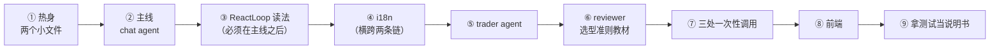

# Agent Harness 阅读指南

**这份文档解决一个问题**：`wiib-agent` 下有两万一千多行 Java（测试另有两万三千行、103 个测试类；再加两门语言的提示词词表约 2500 行、前端对话模块约 3200 行），从哪儿开始读、按什么顺序读、读到哪一段该停下来先补背景。

它不是 API 文档，也不重复 [architecture.md](./architecture.md) 已经讲过的架构。那份文档回答"这套东西是什么"，这份文档回答"**我该按什么顺序把它读懂**"。

> **行号会漂。** 全文一律按**方法名 / 常量名**定位，需要找的时候 grep 名字。个别标了行号的只表示"大概在文件哪个位置"。

---

## 第 0 章 · 先建立地图（10 分钟，只读不写代码）

先读同目录的 [Agent Harness 架构](./architecture.md)，只需要记住三件事：

1. **装置之间只经 PostgreSQL 咬合**。没有任何一个直接调用另一个——chat 想知道 trader 干了什么，读的是 trader 自己写下的表。
2. **选型只有一条准则**：固定步骤写死成代码，开放决策才交给模型循环。同一条准则也管形态内部——chat 一轮的**骨架**（读历史 → 主 agent 跑 → 落库）是几行普通 Java（`ChatTurnRunner`），长活不在轮里等、派成后台子运行（`ChildRunRegistry`）；取什么数、派不派子 agent 这类**开放决策**全在主 agent 那一个 `ReactLoop` 里。
3. **模型来源两条轨**：面向用户的全部 BYOK（用户自带 key，AES-GCM 加密存库）；平台自己只剩 `newsTranslation` 一个功能位（外加可空备用位）买单（见 `runtime/AiAgentRuntime`）——行为分析已在 2026-08 切到用户自己的 key。

### 五处装置速查

| 装置 | 形态 | 循环 | 触发 | 代码在 |
|---|---|:---:|---|---|
| **trader agent** | ReAct 循环（15 工具） | ✓ | K 线收盘 / 波动警报 / 手动 | `trader/`（现场流与轨迹见 5.7） |
| **chat agent** | 单 ReAct 主 agent + 后台子运行 | ✓ | 用户提问 | `chat/`（子运行在 `chat/run/`） |
| **reviewer workflow** | 单次调用，无工具 | ✗ | 日线交接第二阶段 / 点播 | `learning/ReviewRunner` |
| **behavior workflow** | 单次调用，无工具 | ✗ | 对话里的 `analyze_my_behavior` | `behavior/` |
| **replay coach** | 单次流式调用，无工具 | ✗ | 手动复盘点「AI 提示 / AI 评估」 | `controller/ReplayCoachController` |

（还有一处 `analysis/DeepAnalysisService`：Bull∥Bear + Judge 三次调用的**固定编排**，挂在 chat 主 agent 上当工具用、批准后转后台子运行跑，不是独立装置。）

### 建议的阅读顺序



**为什么从 chat 开始而不是从 trader**：trader 是业务最重的（要动真账本、有护栏、有调度），chat 是**循环用得最深的**（闸门 + 保险丝 + 中断 + 收件箱全在主 agent 那一个叶子上，外带两轮之间的上下文整理和一套后台子运行）。先啃循环、再看业务，比反过来省力——trader 里那些看着奇怪的写法多半在 chat 里也出现过，而且 chat 那边有注释解释过为什么。

**i18n 单开一章插在中间**：它不是"翻译"这么简单，它改了叶子的缓存键、改了旧数据的识别方式（认的时候要遍历全部语言）。不先过一遍，读 trader 的提示词组装会一直卡在"为什么这里要传个 lang"。

---

## 第 1 章 · 热身：两个小文件（20 分钟）

目的是熟悉这个仓库的代码风格和注释密度，别一上来就啃几百上千行的大文件（最大的几个是 `JevPredictionRunner` 833 行、`TradeTools` 657 行、`ExperienceLedger` 652 行、`TraderWakeupRunner` 649 行）。

| 文件 | 行数 | 读它干什么 |
|---|---|---|
| `chat/gate/ChatConcurrencyGate.java` | 61 | 全包最简单的一个类。看两件事：`tryAcquire` 为什么**先占用户位再占全局位**（反过来会让同一用户的第二次请求先拿走一个全局名额再被拒，中间那一瞬别人被无谓挡住）；为什么返回**枚举而不是 boolean**（拒因得由闸门自己给，让调用方去别处二次推断既是重新发明轮子又有竞态） |
| `chat/tools/ToolRunContext.java` | 25 | 会话号怎么到工具方法体：`ChatTurnRunner` 把它传给 `ReactLoop.run`，循环执行工具时放进 Spring AI 的 `ToolContext`，工具声明一个 `ToolContext` 参数就读得到（不进 schema，模型看不见）。闸门拿的是同一个会话号，见第 2 章站点 8 |

读完这两个，你应该能感觉到：**这个仓库的注释讲"为什么"不讲"做了什么"**。看到一段费解的代码，先找它头上那句注释，多半解释了它为什么不能写成更直觉的样子。

---

## 第 2 章 · 主线：一次对话从点击到出字（3~4 小时）

这是整份指南的主体。按下面的顺序读，每一站都是上一站的直接下游。

### 站点表

| # | 站点 | 位置 | 看什么 |
|---|---|---|---|
| 1 | 入口与准入 | `ChatWorkbenchController.chat()` | 四道闸全在建流之前；占线直接拒 |
| 2 | 配置从哪来 | `llm/LlmEndpointService` | 端点库 CRUD、用途绑定、解析、探测 |
| 3 | 配置怎么变模型 | `ChatModelFactory.modelsFor` / `fingerprint` | 指纹缓存 |
| 4 | 叶子怎么建 | `ChatAgentFactory.leavesFor` / `leafKey` / `build` | 模型与语言在建叶子这一刻绑死 |
| 5 | 一轮的骨架 | `ChatTurnStreamer.Turn.run()` | 心跳、三种结局、读数 |
| 6 | 一轮的编排 | `ChatTurnRunner.run()`（先读类 javadoc 的 ASCII 图） | 挂收件箱 → 主 agent 跑 → settle，一条直线 |
| 7 | 子运行与唤醒 | `ChildRunRegistry` / `DeepAnalysisToolkit` / `DelegateToolkit` | 长活派出去跑，报告回灌，欠账唤醒 |
| 8 | HITL | `ApprovalGate.intercept` → `ApprovalRegistry` | 三元组授权 |
| 9 | 重新生成 | `ChatTurnRewinder.rewind` | 上下文回退与它的两个陷阱 |

### 站点 1 · 入口与准入

`chat()` 里的顺序是硬的，不是风格问题：

```text
POST /api/ai/workbench/chat
  ├─ 消息非空 / ≤10000 字
  ├─ leavesFor(userId)         端点一条都没有 → 2201 ／ 建不出模型 → 2202
  ├─ concurrencyGate.tryAcquire   该用户已有一轮 → 2203 ／ 全局 10 满 → 2204
  │                               （占线直接拒，不排队：前端把消息留在本地队列，这轮结束自动续发）
  ├─ sessionId 绑 "wb-{userId}-" 前缀，防跨用户续聊
  └─ 这之后才 new SseEmitter
```

四道准入全在 `new SseEmitter` **之前**：一旦返回 SseEmitter，响应就是 `text/event-stream`，再报错只能推 error 事件，前端拿不到结构化错误码、没法自动引导用户去配置。

错误码段位：`2201` 没配置 / `2202` 建不出模型 / `2203` 你已有一轮在跑 / `2204` 全局满了 / `2206` 这条回答重新生成不了 / `2207` 消息超长 / `2208` 会话不欠唤醒。

> 顺带记一个坑：`ErrorCode` 是 Java 枚举，**不校验 code 重复**。撞号了编译过、测试过，只在运行时错乱。加错误码前先扫一遍已占段位（2200 段是工作台，1600 段是 Crypto）。

三个 SSE 端点（`/chat`、`/wake`、`/regenerate`）做完各自的准入后都汇进 `streamTurn()`。`/wake` 的准入多一条：会话不欠唤醒（`childRuns.state(sessionId).pending()` 为假）就 `2208`——别的标签页先接走了，或后端重启丢了标记。这个方法里看两样：

- **名额泄漏是这套设计里唯一不可恢复的失败模式**——漏满 10 个，服务对所有人永久拒绝。所以 `release` 收在**提交出去那个 lambda 的 finally**，外面再补一个 catch 兜"任务提交失败"（那种情况 lambda 的 finally 根本不执行）。
- **名额只管轮，不管子运行**：子运行跑在名额之外（否则一个深研判占着名额几分钟，用户什么都问不了），所以行情配额要另有一道全局闸 `max-concurrent-children`（站点 7）。

### 站点 2~3 · 配置怎么变成模型

`LlmEndpointService` 里有一处值得单看：`create/update` 和 `testConnection` **共用同一份 `toRow` 组装**。不共用就会出现"测通了但存进去的不是它"。同理，连通性探测走的是 `ByokModelBuilder` 的**生产建模路径**，不是另搭一个形似的探针——测什么就得是接下来真跑什么。

顺着 `ByokModelBuilder.build` 往下就是四条协议的分叉（`AiProtocols`）：`openai` 走 Spring AI 的 `OpenAiChatModel`，`responses` / `anthropic` / `gemini` 各是一个自研 `ChatModel`（`llm/` 下三个同名类）。**"能不能服务端搜索"是协议能力与用户勾选的与**——chat-completions 没有标准的服务端搜索，所以 openai 那条永远是 false。这个布尔既进 `ResponsesChatModel` 的构造参数，也决定主 agent 的新闻条款拼哪版，所以它必须进指纹（见站点 4）。

另外**思考档位不设白名单**：`none/low/medium/high` 只是前端的快捷选项，各家还有 `xhigh`/`minimal` 之类，`normalizeEffort` 只抹平大小写空白、只挡列宽（VARCHAR(16)）。认不认只有上游知道。

`ChatModelFactory` 两个点：

- **缓存键是配置指纹，不是 userId**。用户改配置 → 指纹变 → 自然拿到新模型，**不需要任何显式失效逻辑**。但 userId 必须是指纹的第一个分量，理由见站点 4。
- **建模不在锁里做**。写成 `synchronizedMap(...).computeIfAbsent(k, fn)` 的话，mapping 函数整个执行期间持锁，而这条路在准入同步路径（Tomcat 请求线程）上——任何一个用户首次建模期间，其余所有人的 `/chat` 全堵住。所以是 `get` → 锁外建 → `putIfAbsent`。

### 站点 4 · 叶子

`ChatAgentFactory.leavesFor` 的缓存策略与 `ChatModelFactory` 同款（LRU 32、锁外建）。键是 `leafKey` = **配置指纹 + 语言码 + 主模型端点的上下文窗口**：

- **userId 进指纹不是为了缓存粒度，是数据隔离**：叶子里有按用户烤死的工具（主 agent 的 trader_* 工具读的是"这个人的 trader"，子运行按用户计上限），两人共用一份叶子就会看到别人的持仓。隔离要靠键本身，不能指望密文的随机性。
- **语言、上下文窗口只加在叶子这一层，不进模型指纹**：系统提示词与工具描述按语言烤进叶子里，窗口也带在叶子上（`Leaves.contextWindow`，计量条与整理线都按它算），变了叶子必须重建；但模型实例与这两样无关，不该为它们重建 SDK 客户端与连接池。

`build()` 只造一个叶子——主 agent。worker 不缓存，`delegate` 每派一次 `newWorker` 现建一个（账本要独享，循环又是把模型绑死的，只能连循环一起新建）：

| 叶子 | 模型 | 工具 | 特别之处 |
|---|---|---|---|
| `main`（主 agent） | 深 | 16 个（行情 4 + `news_search` + 深研判 + trader 只读 5 + trader 动作 3 + 行为分析 + `delegate`） | `streaming(true)`，带 HITL 闸门、保险丝两样；同批 tool_call 并发；trader 工具与子运行的 userId 建叶子时烤死；不强制 `tool_choice`（Opus 5.5 这类模型不收 any / required），"先取数再答"写在系统提示词里 |
| worker `researcher` | 轻 | `news_search` + 服务端搜索许可（看浅模型那条端点） | 无闸门，任务书是它唯一的用户消息，看不到主对话 |
| worker `analyst` | 轻 | 行情 4 + 指标 3（`klines` / `indicators` / `kline_structure`） | 同上 |

两个 worker 都没有 `delegate`、动作表单与深研判：深度只有一层，派出去的不许再派、不许动手。

叶子还把主 agent 的 `LlmClient` 单独带出来（`Leaves.mainClient`）：两轮之间整理上下文用它发，系统提示词、工具、思考配置与平时一模一样（站点 6）。

**同一个 `runModelCallLimit` 管的是"每个循环各自的上限"而不是"整轮总量"**：主 agent 和每个 worker 各跑各的循环，计数互不相通。一轮对话的模型调用是主 agent 一份加派出去的 worker 各一份，不是 8 次封顶。

### 站点 5 · 一轮的骨架 · `ChatTurnStreamer`

这一层是 2026 年重构出来的，旧指南里的 `ChatWorkbenchController.run()` 已经不存在了。它管的是"一轮在 SSE 通道上的完整过程"：

```text
登记 runRegistry（status 接口 / 拒删会话看它，也是工具推事件的出口；中断信号也登记在这，/cancel 完成它）
  → 开心跳（20s 一帧，nginx 默认 proxy_read_timeout 60s，留 3 倍余量）
  → 落 user 行（重新生成轮与唤醒轮不落）
  → 拼 enriched（时间行 + 提问标记；重新生成靠这两个标记定位本轮提问。唤醒轮换成唤醒指令，答案带【补充回答】标头）
  → turnRunner.run(...)
  → 按结局分流：finishCancelled / finishAnswered，两种 done 都带 pending
```

两个 finish 方法的差别就是这套设计的全部语义，对照着读：

- `finishCancelled`——半截答案照落库（token 已经烧掉了，屏幕上那段也该留得住）。
- `finishAnswered`——落库、（重新生成轮）顶掉旧答案、发 done。**旧答案留到新答案确实落库之后才删**。
- 两种 `done` 都带 `pending`：最后一次模型调用之后又到了子运行报告、这轮没答，前端本地空闲时发 `/wake`（站点 7）。落库必须在 finally 摘运行标记**之前**写完——轮询端不能出现"已结束但查不到答案"的空窗。

还有一个 `turnMeta()`：被中断掐断的在途流 token 未知、账本不可信时**只报耗时不报 token**——宁可不报也不能报错的。meta 里还带这一轮结束时的上下文用量（`context`，底栏计量条用，也随答案行落库），中断的轮不带：工具过程没落库，轮中途测到的偏大。

**断连不中止本轮**：通道关了照样跑完并落历史，只是不再往通道里写帧。前端回来靠 status 接口 + 历史回放补。

### 站点 6 · 编排 · `ChatTurnRunner`

先读类 javadoc 顶上的 ASCII 图，再读 `run()`。一轮是一条直线，没有路由、没有专家派发：

```text
childRuns.attachTurn(sessionId, inbox)   先挂收件箱
  → contextStore.load                   再读历史
  → compactor.shouldCompact ? compact   上一轮用量到窗口 90% 就先整理
  → working = 历史 + 本轮提问 + turnTail
  → streamMain：leaves.main().run(working, sessionId, cancel, listener)
  → childRuns.settle：会话锁里摘收件箱，剩余报告并进终态消息，整体覆盖会话历史
```

四个要点：

- **先挂收件箱再读历史**：挂上之后到的报告进收件箱，`ReactLoop` 下一次调模型前追加到尾部；挂上之前到的已经在库里，随历史读进来。顺序反了就有一个窗口的报告两头都接不到。
- **整理上下文只在两轮之间做**（`ContextCompactor`）：判据是上一轮结束时落库的用量（`context_tokens`，没有就按字数估），到主模型端点窗口的 90%（`compact-trigger-ratio`）就整理。请求 = 整段历史原样 + 末尾一条整理指令（`chat.compact.instruction`），走 `leaves.mainClient()`，请求前缀与上一轮相同、整段命中提示缓存。产物是一条摘要（用户消息）+ 上一轮提问原文 + 最终回答的纯文本，以前的思考块、搜索密文都不再回放。整理失败（报错、模型没给文本）就沿用原历史，下一轮再试。工具循环中间不动历史：各家都要求模型输出只往后追加、原样回放。
- **取什么数由主 agent 自己定**：行情、快讯、trader 只读全是它手里的工具，同一批 tool_call 并发执行（第 3 章）。以前的路由 + 专家那一层没了——路由本身每轮要烧一次浅模型调用，而"要不要查行情"这个判断深模型顺手就做了。
- **`childRuns.settle()` 是每条出路的必经**：正常收尾、用户中断、`streamMain` 抛异常都从它走。剩余报告非空就是这轮没答过的，`TurnResult.pending` 为真，前端空闲时发起唤醒轮。摔了先把 working 落库再抛：用户消息此刻只在内存里，不落库的话下一轮就不知道这句问过。

进模型前垫的最后一条消息（`turnTail`）恒为**用户侧**——整段输入以 assistant 结尾，模型只会补一句"没什么可补充的"。按钮意图（`ChatIntent`）的动作指令也垫在这条里：该做什么已写死，不让模型再猜。这条消息里的**输出语言硬收尾必须排在最后**：用户打的字不翻译，聊天输入随时是另一门语言，而近因权重最高。

`streamMain` 的 `Listener` 做三件事：`chunk` 把 token / 搜索事件 / 收尾帧报的上下文用量交给 SSE 出口，`message` 把模型要调的那批工具推给前端画过程条目，`inbox` 把收件箱里到的报告交给循环。逐帧消费在 `ReactLoop` 里（那边有一条硬规矩：在调用线程上普通迭代消费，不用 `forEachAsync`——后者每个 chunk 叠一层栈帧，长回答会 `StackOverflowError`，真跑实证过）。

### 站点 7 · 子运行与唤醒 · `ChildRunRegistry`（最该细读的一节）

要解决的问题：深研判是三次深模型调用、要跑几分钟；一份调研要读一堆快讯再联网。这些活放在轮里同步等，用户就被名额锁住几分钟什么都问不了；放后台跑，主 agent 先答能答的，报告回来再补。

一套子运行时管两类活（`ChildRun.Kind`），区别只在任务书是谁写的：

- `DEEP_ANALYSIS`：任务书代码写死。`run_deep_analysis` 过了闸门不再同步跑，`spawn` 一个子运行后立刻返回 `{"status":"RUNNING"}`。
- `DELEGATE`：主 agent 现写任务书、选一个 worker 预设（`researcher` / `analyst`），`DelegateToolkit` 建 worker 跑，最后一条有正文的助手消息就是报告。

```text
spawn(spec, body)
  ├─ 用户开关（WorkbenchPrefService，只管 DELEGATE：深研判是用户在确认卡上点过头的）
  ├─ 该用户在跑数 ≥ 上限（默认 3，用户可调到硬上限 5；按用户不按会话，与名额闸同口径）
  ├─ 全局信号量 max-concurrent-children（行情配额按出口 IP 算，子运行在名额之外，得另有一道闸）
  └─ 登记 → 虚拟线程跑 body → orTimeout(child-timeout-seconds) → finish
       拒了：拒因原样回给模型（{"error": ...}），这部分它自己用工具做

finish → 拼报告（用户侧消息 + 【后台任务#id label 状态】标注，正文截 child-report-max-chars）→ deliver
deliver（会话锁内）
  ├─ 会话挂着一轮（attachTurn 过）→ 进收件箱，ReactLoop 下一次调模型前追加到尾部
  └─ 没挂 → load + add + save 直接落进会话上下文，标 pending
pending → done / status 都带着 → 前端本地空闲时 POST /wake → 唤醒轮据报告补充回答
子运行比那轮活得久 → 事件推不出去 → status 报每个子运行的结局与步骤 → 前端空闲时轮询它补过程轨、见 pending 唤醒
```

读的时候盯这几处：

- **为什么要会话锁分两条路**：`ChatContextStore.save` 是整体覆盖。轮进行中直接写库，会被那轮结束时的保存抹掉；所以轮在跑就只能进收件箱，由轮自己落库。轮结束那次保存（`settle`）也在同一把锁里：报告正赶在摘收件箱和落库之间到，锁外就会被这次保存盖掉。
- **报告为什么是用户侧消息**：裸 AssistantMessage 模型会当成"我自己说过的话"，整段输入还以 assistant 结尾，于是倾向于答"没有数据"。标注说明它是谁回来的，唤醒指令（`chat.wake.instruction`）再点一遍"这不是你说过的话"。
- **失败也回灌**：超时、worker 抛异常都拼成一条失败报告（`chat.childRun.status.failed`），主 agent 得知道这件事黄了才能改口；只有**取消**的不回灌。
- **谁取消**：`/cancel`、重新生成、删会话都 `cancelAll` / `purge`。重新生成必须取消：被顶掉那轮派出去的报告回灌到重跑后的上下文里会答非所问。
- **唤醒由前端发起**，后端只标 pending 不偷跑：不欠就 `2208`（别的标签页先接走了，或后端重启丢了标记）。唤醒轮不落 user 行，答案带【补充回答】标头，`ChatRowKind` 把这种行与老的补答行归成一类，不给重新生成。
- **子运行的账单独算**：每个 worker、每次深研判各自现包一个 `UsageTrackingChatModel`，用量只打日志，不进主轮的账本——主轮 done 里报的 token 是主 agent 自己的。子运行跨轮活着，记进主轮那本会串到下一轮（下一轮开头 `resetUsage` 换了账本，晚发起的调用就记到新账上）。
- **主体要看取消信号**：`spawn` 的约定。worker 把 `run.cancel()` 交给自己的 `ReactLoop`，在检查点停；深研判在 Bull/Bear 收齐、裁决之前看一眼 `run.cancelled()`，取消了就不烧裁决那次（单次模型调用是阻塞的掐不断，能省的只有这一次）。
- **开关不进叶子缓存键**：每次 `spawn` 现读 `user_workbench_pref`，开关只影响拒不拒，工具表不随它变；关了开关模型照样看得见 `delegate`，调了会收到拒因。
- **行为分析有意不走子运行**：它只有一次模型调用，而且报告卡片事件靠本轮通道推，放后台就没通道可推了。
- 一切都是**进程内存级**：重启丢在跑的子运行与 pending 标记，已落库的报告还在上下文里，重问即可。

### 站点 8 · HITL · `ApprovalGate` / `ApprovalRegistry`

先理解约束：`DeepAnalysisToolkit` 的方法体**从来看不到自己被调用时的 sessionId**——工具方法体拿到的只有 `ToolContext` 里的会话号，没有当次 tool_call 的参数。授权若只绑 sessionId，就会是"卡片上写 BTC、模型改口跑 ETH 照样放行"。

修法不是加校验，是**把判断挪到信息完整的那一层**。`ApprovalGate` 实现 `ReactLoop.ToolGate`，循环执行工具前把会话号和整条 `AssistantMessage`（含每个 tool_call 的名字与参数）交给它，所以授权键能做成 `(sessionId, 工具名, 归一化后的标的)`。

两处当前版本的要点：

- **管辖范围只剩深研判一个工具**（`GUARDED_TOOLS`）。trader 那三个工具只弹表单、真正的执行扳机在用户手指上，再批准一次等于让用户确认两遍。
- **不受管辖的工具原样放行**。工具方法体自己的 sessionId 不经闸门：`ChatTurnRunner` 把它传给 `ReactLoop.run`，循环执行工具时放进 `ToolContext`（`ToolRunContext.SESSION_KEY`）。
- **一批里两个以上贵操作整批不跑**（`chat.hitl.oneAtATime`）。闸门放行是整批放、授权却只对一件事：BTC 已批、模型把 ETH 捎在同一批里，按第一个命中就放行的话 ETH 也跟着烧三次深模型。整批回"一次只能一个"，模型拆开重调，BTC 放行、ETH 弹卡。

再看 `discardApprovals` 那段注释：又要弹卡就说明上一条授权已经用不上了（用户批了 BTC、模型又改口要 ETH），不丢的话它会一直躺到 TTL 结束，之后 10 分钟内模型若又调 BTC 那件事会被它放行，用户以为自己没点过头。

闸门放行之后工具也不同步跑：`runDeepAnalysis` 起一个子运行立刻返回 RUNNING，裁决作为报告回灌、主 agent 被唤醒补答（站点 7）。

### 站点 9 · 重新生成

`ChatTurnRewinder.rewind` 把模型侧上下文回退到"最后一问已在、回答未出"。展示表这里一行不动——旧答案要留到新答案确实落库之后才删。

**它不在 controller 里**：这段跨 `ChatHistoryService` / `ChatContextStore` / `PromptCatalog` 的回退逻辑一行 HTTP 都没有，独立成类才立得起来单测。controller 那边只剩一句 `rewinder.rewind(...).orElseThrow(2206)`——回不去的几种原因在 HTTP 上是同一个码，不分型。

两个陷阱都在私有的 `cutAt`：

1. **光靠轮起始标记定位不住**：整理上下文会把上一轮的提问**原样**留在摘要后面，老会话的压缩还把首条用户消息原样放在队首，那几条同样带着标记。所以标记只用来找候选，还要拿它与展示表里那条提问核对。
2. **老会话切在队首且紧跟着摘要（`SystemMessage`）就得拒**：同一句常用问法在一个会话里问两遍就会这样，文本对得上但位置是假的，照切会把整段上下文连摘要清空。新的整理不往历史里写 `SystemMessage`，这条只命中老会话。

两条都交回 `Optional.empty()`，由 controller 一律翻成 `2206` 拒绝，不做半吊子的补偿。另外重新生成前要 `childRuns.cancelAll`：被顶掉那轮派出去的子运行作废，它们的报告回灌到重跑后的上下文里会答非所问。

---

## 第 3 章 · ReactLoop 读法（读完回头看站点 4）

叶子的 ReAct 循环是自己写的，就 `llm/ReactLoop` 一个类：调模型 → 有 tool_call 就执行 → 回执接回历史 → 再调模型，直到模型不再要工具。`run` 那几十行就是全部语义——**先读类头注释（新形态的权威描述在那儿），再对着读 `run`**，比读这一章快。下面四条是容易一眼滑过去、写反了又不报错的地方。

### ① 三条顺序约束是源码顺序

`run` 里那几个 if 的先后不是随手排的：

- **轨迹在保险丝外层**：模型给出 tool_call 就记，被保险丝拦下、根本没执行的那批也记——要看的是"模型想调什么"，trader 的动作轨迹是主人回看的依据。
- **保险丝在闸门外层**：到上限直接补占位回执收尾，不再问闸门。反过来会出现"逼近上限时闸门先弹了卡，模型已经没配额把这件事告诉用户"。
- **收尾提示贴本轮回执**：倒数第二次调用（最后一次能执行工具）的回执末尾贴一句预算已尽，闸门合成的那条回执同样要贴——下一次模型调用直接收尾，不撞上限硬切。

写反了代码照跑、什么都不报错，只在特定路径上出错。所以顺序钉在 `ReactLoop.run` 的源码里，不是配置项，也没有"注册顺序"这回事。

### ② 可空参数漏传，编译照过

`gate`（HITL 闸门）、`trace`（工具调用轨迹）两个建造参数都可空：忘了传，循环照转，那一样静默哑掉——不弹卡、轨迹空一片。必填的只有 `client` 与 `limiter`，漏了 `build()` 当场抛。

两根钉子守着，都是**建生产叶子真跑**而不是自己搭一个循环自己塞：

- `MainLeafTest.闸门在生产叶子上拦下未授权的深研判`
- `TraderWakeupLoopTest.dataToolCallsTracedIntoActions`

### ③ 中断

`cancel`（一个 `CompletableFuture<Void>`）直接传进 `run`，两头同时管：

- **掐在途流**：`LlmClient.streamingExecute` 用 `takeUntilOther(Mono.fromFuture(cancel, true))` 把整条流水线（含重试）掐断，取消传到 WebClient / SDK 流。`suppressCancel=true` 必须给——缺省会在流正常结束时反向 cancel 这个 future，循环的中断检查点会把一次正常收尾当成用户中断。
- **循环退出**：两个检查点，模型答完之后不再执行工具、工具回执入历史后不再调模型。两处都是正常退出、把已有历史交出去，不抛异常。拉流时每帧还先看一眼 cancel：掐上游那一刻队列里排着的帧也不再上屏。

被掐断那次调用的 token 未知，`markAbandoned` 让本轮的账退化成只报耗时；账本按轮换新（`UsageTrackingChatModel.TokenLedger`），晚到的入账只会落进旧账本。测试：`ChatCancelTest`、`LlmClientTest` 的中断两条。

### ④ 系统提示必填

`LlmClient.builder().systemPrompt()` 空值 `build()` 当场抛，没有"静默换成框架默认提示"的通道。系统提示是每一处模型调用的纪律与格式约定，静默换掉等于整份内容凭空消失，而且不报错。

### ⑤ 同批并发与收件箱

同一条回复里的多个 tool_call 并发执行（虚拟线程），回执仍按 tool_call 顺序配对合成一条——顺序稳定，产出才可复现。批内出现 `serialTools` 里的任一工具（trader 的开平仓那几个），整批退回按原顺序串行，不拆成"并行的先跑、串行的排后面"：账户状态类工具不该和同批任何别的调用交错。每次调模型前从 `Listener.inbox()` 取一次外部到达的消息（子运行报告）追加到尾部，只追加不插入。测试：`ReactLoopTest`。

### 附：其他值得知道的事实

| 事实 | 为什么要知道 |
|---|---|
| `UsageTrackingChatModel.getOptions` 必须原样透传 | 返回自己造的 options 会让 `LlmClient` 挂出去的工具列表变成空数组 |
| `options` 必须从 `model.getOptions().mutate()` 派生 | Spring AI 2.0 的 `OpenAiChatModel` 把 `prompt.getOptions()` 直接硬转 `OpenAiChatOptions`，塞个泛型 builder 造的进去当场 ClassCastException。真跑实证过：那一次调用当场抛，整轮一个工具都没跑 |

---

## 第 4 章 · i18n：三个类改变了很多签名（40 分钟）

| 类 | 管什么 |
|---|---|
| `i18n/PromptCatalog` | **喂给模型**的东西：系统提示词、工具描述，以及 AI 产出后落库、跟 trader 主人语言走的话（决策 error/reasoning、paused_reason）。词表在 `resources/prompts/{zh,en}/*.yml` |
| `i18n/LocalizedToolCallbacks` | `@Tool(description=...)` 是编译期常量换不掉，所以自己拼 ToolCallback：名字与 inputSchema 照旧由注解推导，只把 description 换成 `tool.<工具名>` 那条。它还兼了 `FailureAsResult`：**工具失败包成回执回给模型，不抛出**——`ReactLoop` 执行工具不接异常，抛出去整轮就没了。写工具自己都 catch 了，这层兜的是数据工具（K 线首拉失败会原样抛）和参数解析失败 |
| `i18n/UserLangResolver` | 查用户的 AI 产出语言（lang 列在 sim 的 user 表，走 internal API）。不加缓存——缓存换来的是"刚切完语言还出旧语言" |

三条规矩，读到别的地方会反复撞上：

1. **给模型看的走 `PromptCatalog`，给用户看的走 `MessageCatalog`**。两者语言来源不同：前者跟 trader 主人 / 叶子的语言，后者跟当次请求的界面语言。
2. **读旧数据认全部语言，校验本轮输出只认当前那门**。这条有两面，别用反：
   - 库里的旧数据是写入时那门语言落的，所以 `ChatRowKind.of`、`ContextCompactor.lastExchange`、`ChatTurnRewinder.cutAt`、`DecisionText.locateConclusion`、`ExperienceLedger.isRendered` 全都逐语言各认一遍。认死一门就会静默失配——补充回答行冒出"重新生成"按钮、整段结论被判成"没写结论块"。
   - 反过来，`ExperienceOpParser.parse` 校验的是**模型本轮刚交出来的东西**，只认本轮提示词那一门的标记与行首固定词：提示词刚让它用英文标记、它交回中文标记，那就是没照格式走，按格式失守降级才对。两门都认会把真失守悄悄放过。
3. **用户自己写的字不翻译**：`customPrompt`、`ownerNote` 原样注入，前面垫一句"这段是主人亲笔、可能是另一门语言、照意思做但输出语言不变"。

`@ToolParam` 的参数描述**不跟语言走**（嵌在自动推导的 inputSchema 里，换语言要在 schema 层逐字段改写，复杂度不值），全仓统一写英文。

---

## 第 5 章 · trader agent（2.5 小时）

业务最重的一套。循环用法比 chat 简单——一个 `ReactLoop`，没有多专家编排；难在**注入面**。

### 5.1 谁来敲门 · `TraderScheduler`

5m K 线收盘事件是唯一时钟。四个唤醒入口全在这个类里做准入治理：

| 入口 | 方法 | 治理 |
|---|---|---|
| 例行 | `onKlineClosed` → `fireInterval` → `fireTrader` | 对齐 interval 边界 → `WakeWindow` 时段过滤（时段外静默跳过，**不写 SKIPPED**）→ 边界去重 → 每 trader 互斥 |
| 波动警报 | `tryAlertWake` | 停工窗口 → 时段 → 冷静期 5min → 预算预检 → 互斥 |
| 手动 | `tryManualWake` | `manualWakeBlockedReason` 预检（面板显示的拒因就是真点下去会拿到的那句）→ 再抢一次互斥 |
| 点播复盘 | `tryOccupy` / `release` | 借同一个 inFlight，两边才不会对同一个 trader 各跑一篇复盘把 memory 互相覆盖 |

**不做兜底补漏**：WS/事件断流丢的 K 线就丢了——陈旧信号唤醒没有意义。

`startDailyHandover` 是本功能唯一的全局同步点，读的时候盯三样：

```text
阶段0 全体例行唤醒**发出**（不等结果）
  →【停工窗口开】挡住全部四个入口  ← 发完就开，不是跑完才开
  → join 等在途交易全部结束（复盘读的才是定格的一天）
阶段1 全体复盘并行，join 等全部复盘落库
  →【停工窗口关，在 finally 里】 ← 关不上全体 trader 就永久停摆了
```

**窗口为什么要在 join 之前开**：晚开的话，5m 档会在阶段 0 等待期间又撞上一次边界醒来、占住 inFlight，那个 trader 的复盘就被 `phase()` 跳过了。代价是窗口把阶段 0 的交易执行也圈了进去，上界从「复盘 600s」变成「唤醒 600s + 复盘 600s」。

`phase()` 里 inFlight 抢不到就跳过该 trader 本阶段：硬等会拖住全体，而复盘明天还有机会；这也是复盘不脏读的第二道闸（窗口挡新唤醒，inFlight 挡残留的旧唤醒）。

配套读 `VolatilitySentinel`（探测层，5min 滚动窗口振幅，阈值 180 天历史校准过，类注释里附了重跑校准的 SQL）、`AlertTrigger`、`WakeWindow`（北京时间写死 `Asia/Shanghai`，不跟 systemDefault 漂）。

### 5.2 四层外生停止条件 · `TraderWakeupRunner` 顶部常量

| 常量 | 值 | 管什么 |
|---|---|---|
| `MIN_WAKE_SECONDS` | 30 | 距下一边界不足此数=事件迟到，放弃本轮**不算失败** |
| `MAX_WAKE_SECONDS` | 600 | 单轮时长硬顶 |
| `MAX_MODEL_CALLS` | 12 | ReAct 保险丝 |
| `MAX_CONSECUTIVE_FAILURES` | 5 | 连败自动 PAUSED |
| `BUST_OUT_FLOOR` | 100（BigDecimal） | 权益跌破初始 1% 判出局终局 |

**模型无权突破任何一条**——四层都是外生的，写在代码里，不在提示词里。提示词里的约束模型可以无视，代码里的不行。

`MAX_MODEL_CALLS` 的值要连着常量注释一起读：给到 12 是因为**并不并行差得远**——会并行的模型一轮发 4~9 个 tool_call，两三次就取完数据；不并行的一轮一个，多币多周期求证根本走不完。（注释里写的是「5 币」，那是上限改 12 那会儿的旧币种档，币种上限后来才收到 3。）撞上限本身不算失败，但收束时最后一条若是纯 tool_call、正文为空，这轮就没有收尾的结论块，下一轮的检验旧论点和复盘素材都跟着缺。所以 `ModelCallLimiter` 除了拒，还会在**最后一次能执行工具**时往回执末尾贴一句收尾提示（`llm.callLimit.lastCall`），让模型下一次调用直接给结论。

同一条回复里的多个 tool_call 由 `ReactLoop` 在虚拟线程上**并发执行**，回执仍按 tool_call 顺序配对；批里出现 `TradeTools.SERIAL_TOOLS` 里的任一动作工具（开平仓、止损止盈、写计划、撤单），整批退回按原顺序串行——账户状态类调用不和同批别的调用交错。

同一笔账还管着币种上限：`TraderService.MAX_SYMBOLS = 3`（一个币扎实求证约 3 次），在**保存配置**时就挡住，不在 `TradeGuard` 里；前端 `MyTrader.MAX_SYMBOLS` 是同一个数，改要一起改。

`BUST_OUT_FLOOR` 只是常量改了名（原 `LIQUIDATION_FLOOR`，类型也换成了 `BigDecimal`），**状态枚举仍是 `AiTrader.STATUS_LIQUIDATED`**、词表里仍写「爆仓」——别顺手一起改。

唤醒预算 `wakeBudgetSeconds` = `min(下一边界 - 5s - now, 600s)`：**唤醒决不占用下一根 K 线**。

### 5.3 一次唤醒的生命周期

`doWake` 是骨架，读的时候注意两个"单独 try"的理由：

- **动作后刷权益单独 try**：会话成功 = 这轮就是成功，刷新只是锦上添花。sim 抖一下若翻进外层 catch，决策全文会被丢掉、整轮判 ERROR 还计连败——连 5 次自动 PAUSED，可每轮其实都下过单了。
- **`decision.getId() != null` 就直接 return**：决策行已经落库了，异常出在收尾。改写成 ERROR 是错的，而且 MP 自增主键回填后再 insert 必撞主键，异常会直接逃出唤醒回路。

`recordFailure` 里 key 无效**不等连败当场停**：再攒够连败也只是原样重炸几轮，能修的人只有用户自己。

`runAgentSession` 是会话本体：

```text
UsageTrackingChatModel 每轮新建（工厂里的模型实例是跨唤醒缓存的，装饰器不新建会跨轮累加）
  → TradeTools 每轮 new（绑 sim 子账户 / 白名单 / 风险规格 / 本轮截止时刻）
  → 计划对账（TraderPlanStore.reconcile：逐份 LIVE 计划对 sim 持仓/挂单，出 Reconcile(live, events)；已平仓位懒取）
  → 组装系统提示词（promptAssembler.assemble）、观察包（observation）与开场白（routine / alert instruction）
  → LlmClient（系统提示 + 15 工具；不强制 tool_choice，"先读事实、用工具求证"在开场白里）
     + ReactLoop（streaming(true)：模型文本逐字推给唤醒现场，见 5.7；ModelCallLimiter 保险丝；ToolCallTraceHook 轨迹）
  → FutureTask 限时执行
  → finally：动作轨迹与用量**无论成败都要落**（超时作废那轮，单和 token 都是真发生的）
```

`mergeActions` 的合并规则：顺序骨架来自轨迹收集器的全量记录（含数据工具），交易工具用 `TradeTools` 的富记录（带结果/拒因）按序替换轻量占位。

`finalReasoning` 往前找**最近一条有正文的**助手消息，而不是死盯最后一条——保险丝收束时末尾是纯 tool_call，死盯就会写出 status=OK 却一个字没有的决策行。

### 5.4 注入面（最该细读的一段）

一次唤醒喂给模型的东西分两块：**系统提示词**（`TraderPromptAssembler.assemble`）和**开场白**（`routineInstruction` / `alertInstruction`）。分工是：system 只放"你是谁、怎么答"——模板 / 经验账本 / 主人风格指令 / 固定收尾格式 / 输出语言；开场白只放"这轮发生了什么，回答问题"——头部事实 + 观察包（`TraderWakeupRunner.observation`：事件 / 账户 / 上一轮结论 / 轨迹 / 战绩）+ 快照 / 日历 / 休眠提示 + 单问题 + 留言。模型要"重建"的东西（上一轮等的是什么、仓位为什么不见了、现有杠杆几倍）全部由代码算好直接给。

`TraderPromptAssembler` 的类注释里那**七条认知设计**是这套东西的设计文档，逐条对着代码读。特别注意第 ⑦ 条（最近改的）：

> **主人留言不进系统提示词，进唤醒开场白末尾**。system 里的字是"背景规则"，跟纪律同层必被纪律压过；进了 user 消息它才是"本轮要回答的问题之一"。举证责任倒置——执行不需要理由，否决只认两种：撞系统硬规则、引用具体数字的独立判断；**纪律条文不是否决依据**。

`ownerNoteBlock` 与 `consumeOwnerNote` 必须一起读：**注入即消费**，递减紧贴注入写在一起。拆成两处迟早掉进两个坑之一——注了没减（留言每轮重念，模型把阶段性交代当长期规则）、减了没注（主人的话直接蒸发且无人知晓）。递减用条件 SQL，以"库里的正文仍是我注入的这条"为前置：trader 是调度时刻的快照，取到这里之间主人可能已在面板改写。

`closingFormat` 是**系统强制块**，不看平台模板开关：

> stale 剔段、唤醒回注全靠结论块里的 `[SYMBOL]` 段切分（`DecisionText.splitSegments`），格式丢了下游全退化。所以骨架按 trader 真实币种生成——模型照着填，不用自己猜币码。结论块还是账本引用计数的来源：里面出现的 `#编号` 由 `TraderWakeupRunner.recordCitations` 记到对应条目上（开仓轮 / 观望轮分开数）。

其余注入块：

| 块 | 来源 | 要点 |
|---|---|---|
| 自上次唤醒以来 | `events` | 素材就是上一步 `reconcile` 按发生顺序给出的事件：`Closed` 说结局（止损/止盈/主动平、成交价、盈亏、当时的失效条件），`Filled` 说限价单成交计划绑上仓位，`Cancelled` 说挂单撤了计划归档；一份计划对应一个仓位生命期，旧仓了结而同键加仓单还挂着时旧计划归档、论点续立一份新计划接着等；没事件整块缺席 |
| 账户状态 | `accountStateJson` | 持仓带杠杆/标记价/强平价、计划与修订历史（时刻可读）、挂单带已挂时长。持仓另带 `sinceLastWake`（`PositionPath` 算窗口，极值复用 `CaseFileBuilder.market`）：自本局最近一条 OK 决策行以来本地 5m 的首根开盘、最高最低各在何时、末根收盘、涨跌，from / to 是实际覆盖的起止；还没有 OK 行或仓位是那之后才开的，从开仓所在那根算；窗口里没收盘根就不带。一次给足，工具预算才能留给行情求证 |
| 上一轮结论 + 轨迹 | `lastConclusion` / `trajectory` | 两处共吃 `recentWakes` 一次查齐的那份 `List<RecentWake>`（别各查各的）：结论完整回注（最近一条写出结论块的 OK 行，整块不截断）+ 轨迹一行一轮（时刻/状态/权益/工具名或失败原因）。只回注交易类（TRADE/ALERT/MANUAL），REVIEW 已走账本注入。被主人标记忽略的交易在 `RecentWake` 里就已剔掉内容，行头的时刻/状态/权益原样留着——那是唤醒事实，不是教材 |
| 论点战绩 | `PlayStatsAssembler` | 纯代码算，模型只许引用不许自算；stale 过滤在**配对之后** |
| 财经日历 | `EconCalendarAssembler` | 三段：刚公布（上一边界以来新落地的实际值，置顶）→ 过去 3 天已公布 → 今天剩余即将公布，只给事实不给指令 |
| 经验账本 | `ai_trader.memory`（`ExperienceLedger.render` 的渲染文本） | 账本首行带用法说明：假设只供参考，限制型规律能否当观望理由看主人的 `learned_restriction_hold` 开关 |
| 休眠提示 | `sleepNotice` | 时段内末次唤醒才有。明说休眠本身不是任何方向动作的理由——"13 小时看不见"既诱导睡前减仓，也诱导赶在休眠前多开一笔 |

### 5.5 动手面

`TradeTools` 7 个交易工具（`get_account` / `open_position` / `close_position` / `set_stop_loss` / `set_take_profit` / `write_plan` / `cancel_order`）**不用逐个读**，挑两三个看形状即可。数据工具 8 个在 `toolkit/`（`klines` / `indicators` / `kline_structure` / `market_snapshot` / `option_iv` / `funding_history` / `orderbook_depth` / `news_search`），加起来正好 15 个。

三个设计点：

- **事实裁定归代码**：`TradeGuard.validateOpen` 越界**拒绝不截断**。平台悄悄把杠杆从 50 改成 20，模型不知道自己被改了，后续所有止损计算全错。拒因用主人的语言给回去，模型可以修正后重试。
- **计划即承诺**：开仓必须给论点标签、数据引用、失效条件，落 `ai_trader_plan`，每次唤醒原样回注。怎么退出由主人的交易指令定（平台预填的默认指令写的是止损、止盈、失效条件、主人留言四条路，可改可删）。计划归档不删，是 reviewer 的原料。
- **调仓不设闸门**：加仓/减仓由模型自己拍板、当场成交，没有人工确认那一跳。中间插一道审批，agent 就退化成建议器；风险由 `TradeGuard` 的硬护栏和自动止损兜，不靠人点头。

`toolkit/IndicatorToolkit` 的类注释里有一句话值得记住：**这里只出中性的原始事实与公开标准指标，不替 trader 做任何形态/结构判读**——用户的交易思路是从提示词灌进来的（缠论、道氏、量价各家都有），代码每多算一层结论就等于替它选了一派。

### 5.6 对外面

`TraderActionService` 是三个动作（留言 / 手动唤醒 / 点播复盘）的**唯一实现**，执行入口只有动作面板这一条 REST。`TraderChatService` 是对话轨读 trader 的**唯一入口**，只查不写。两个类的类注释就是"两条 agent 链解耦纪律"的落地说明。

### 5.7 现场与轨迹（后加的一条链，跟着读一遍）

唤醒过程能逐帧看，这条链只有三个文件，但**职责切得很干净，值得照着学**：

| 文件 | 管什么 | 不认识什么 |
|---|---|---|
| `trader/WakeTrace` | 一次唤醒的过程状态（纯数据）。每个变更方法**返回要外发的帧**，`replay` 按当前状态合成回放帧，`toJson` 是落库形状 | 不认识 SSE、ReactLoop、Spring 容器 |
| `trader/TraderLiveHub` | 订阅者管理、扇出、心跳。按 traderId 订阅，一次唤醒一个 `Run` 句柄，runner 只碰它 | 不认识 ReactLoop |
| `controller/TraderController` | 准入：谁能连 | — |

帧序列：`run_start` → `prompt` → 每次模型调用的 `model_start` / `token…` / `model_end` → `tool_result…` → `run_end`。中途连上按当前状态回放，空闲只有心跳。

读的时候盯这几处：

- **两个时间常量的由来**：心跳 20s（nginx 默认 `proxy_read_timeout` 60s 会掐静默连接，留 3 倍余量）、订阅 30 分钟到点让前端重连。与 chat 那边的 `ChatTurnStreamer` 同款理由，可以对照。
- **准入不在 hub 里，在 controller**：hub 只管"按 traderId 扇出"，谁配连是 controller 判的。
- **两个接口的拒法故意不一样**：`/{id}/live` 对非主人直接抛（前端 `getSse` 见到 JSON 就按接口报错处理）；`/{id}/decisions/{decisionId}/trace` 对非主人**回 `null`，与"这条老决策没有轨迹"同一个形状**——轨迹入口本就藏在主人才见得到的按钮后面，报错反倒把"有这东西"讲了出去。
- **工具回执预览截 2000 字**（`WakeTrace.PREVIEW_CHARS`）：轨迹要落库进 `ai_trader_decision.trace_json`，K 线回执几万字原样存进去没有意义。
- **前端门控必须在父层**：`pages/ArenaDetail.tsx` 里那句注释说得很清楚——`LiveRunCard` 一挂载就建流，卡片内部 `return null` 拦不住。

测试：`TraderLiveHubTest`（扇出与订阅）、`WakeTraceTest`（帧与落库形状）。

---

## 第 6 章 · reviewer：素材算得齐就不给模型循环（1.5 小时）

`learning/` 包里住的是 reviewer：单次调用的 workflow，没有工具也没有循环。**它是"选型准则"的正面教材**——素材能由代码算齐的（复盘自己），就不给模型循环，模型只负责解读与填表。

### reviewer：自己看自己

| 位置 | 看什么 |
|---|---|
| `ReviewMaterialAssembler.hasNewMaterial` | 窗口内有了结仓位、或有过 `open_position` 动作（被拒的也算）才复盘；都没有**静默跳过不烧钱**，窗口并入下次 |
| `ReviewMaterialAssembler.assemble` | 纯代码算五块素材：战绩表 / 本局论点战绩 / 案例事实表 / 本期行情 / 经验账本。素材窗口 =（上次成功 REVIEW 的 wake_time, 本日线边界]。案例按单子类型分组，两笔以上的组在前、再按净额绝对值，只展开前两组（★），其余一行带过 |
| `CaseFileBuilder.path` | 一笔交易在 5m K 线上的路径指标：最大浮盈 / 最大逆向（占计划目标 / 止损距离的比例）、到目标 25%·50% 用时、首次收回入场价、出场后 4h·24h 最有利价。配上 `EntryContext` 在开仓那一刻存下的 regime / ATR / 事件距离 / 时段 / 资金费，模型才答得出"赢单和亏单差在哪" |
| `ReviewRunner.review` | 一次调用进去出来，无工具无循环；有待复审条目再调一次 `audit`；旧自由文本 memory 第一次跑时 `needsMigration` / `migrate` 压成账本行。迁移 / 复盘 / 复审三次调用共用 600 秒总预算 |
| `ExperienceOpParser` | 两段固定格式：【本期复盘】→ REVIEW 决策行公开上时间线；【经验更新】→ 逐行翻成账本操作（`#id 支持/反对/未测试/守/破`、`新增 …`、`发现 …`、`删除 #id`），认不出的行丢掉。**一行都解析不出时 REVIEW 行照存、账本不动**——一次格式失守不污染记忆 |
| `ExperienceLedger` | 记账规则全在代码：假设支持满 3 次升规律；近 5 次反对 ≥3 / 反对追平支持且核对 ≥4 / 连续 6 次未测试 → 举旗；复审保留后不满 3 次新结论不重举；现役 10 / 同类 3 / 限制型 2 的上限；删除只对假设；退役不删行。`render` 把现役条目渲染成 trader 注入的文本并写回 `ai_trader.memory` |
| `reviewer.system` 词表 | **事实纪律三件套**：数字只许引用事实表、失败界定与处理必须是可观察的价格/根数/时间、主人指令里已有的不进账本且上期教训不许重抄 |

**为什么不给它工具**：给了它就能自己去查一段对自己有利的行情来自证。素材由代码算齐、模型只负责解读，这是有意的约束。

**为什么账本不交给模型整份重写**：原来的滚动继承（只回注上一期、要求模型把仍成立的教训抄过来）让"进化"变成每天重抄一遍；换成代码记账后，模型每期只对现役条目给结论、只提议新增，计数与升降级都不由它说了算。退役也不自动：代码只举旗，模型拿着整条结论流水复审四选一（保留 / 修订 / 拆分 / 退役），一条支持过 100 次的规律不会因为连输 3 天就消失。

**降级安全**：复盘失败**不计连败**（没有资金风险，不值得暂停机制），只留 ERROR 行。

### 顺带：配对与结论块的两个共用件

`TradePairing` 同时服务三个地方（复盘案例 / 竞技场已了结交易 / 论点战绩统计），所以配对算法只能有一套：`pairAll` + `bestMatch` + `closeMannerKey`。各配一套会自相矛盾。

`DecisionText` 是"结论块格式"的下游，读完第 5.4 节的 `closingFormat` 再回来看：

- `splitSegments`：结论块按 `[SYMBOL]` 切段。
- `staleFiltered` / `staleFilteredToolNames`：主人标记忽略某笔交易后，**新格式剔掉对应的 `[SYMBOL]` 段；错误格式（模型没按币分段）无段可剔，落在 stale 计划生命期内的轮整行剔除**。没人标忽略时错误格式的行原样保留。唤醒回注 / chat 共用这一套；复盘素材不再读决策时间线，stale 在它那边是"配对之后把计划被忽略的交易整笔从案例与统计里拿掉"。

---

## 第 7 章 · 三处一次性调用（1 小时）

这三处的共同点：没有工具、没有循环，一次调用进去出来。**理由都是"模型在查什么上没有决策自由度"**，套 ReAct 循环只是让它来回跑腿——多花钱、多花时间、多一堆失败模式，换不来任何决策质量。

| 装置 | 入口 | 要点 |
|---|---|---|
| **behavior** | `chat/BehaviorToolkit` → `BehaviorAnalysisService` → `BehaviorAnalysisWorkflow` | 并发拉 sim 的 7 个 internal 端点 → 拼一个 prompt → 调**一次** LLM。**准入层必须经过**（缓存 30min / 失败负缓存 / 并发闸门）——模型一轮里连点三次就是连烧三次。模型由调用方传进来，用的是用户 BYOK 的深模型：平台 behavior 功能位已退休 |
| **replay coach** | `controller/ReplayCoachController` + `analysis/ReplayCoachPrompts` | 一次 BYOK 流式调用，SSE 协议与工作台同款。**不进会话历史、不记忆、不排队**，只挡"上一次还没跑完又点"；断连即停（没有落库诉求，用户切走了就别再烧他的 token）。两个硬约束在 `ReplayCoachPrompts`：只依据给定数据（盲测局禁止猜日期）、中性不下单 |
| **deep analysis** | `chat/DeepAnalysisToolkit` → `analysis/DeepAnalysisService` | 严格说是**固定编排**不是单次调用：Bull∥Bear 虚拟线程并行 + Judge 裁决 = 3 次深模型调用，所以它是唯一挂 HITL 闸门的工具。产物落库后由 `analysis/NarrativeVerificationService` 到期（H12）拿真实走势对账——叙事轨也要有战绩 |

behavior、replay coach 和指令生成器的写稿人直接建 `LlmClient` 用（不进 `ReactLoop`），系统提示同样是 builder 必填项，漏了 `build()` 当场抛。

---

## 第 8 章 · 前端（1.5 小时）

对话模块约 3200 行，比后端好读得多，但比旧版复杂——排队/唤醒补答/后台子运行轨/中断/重新生成五件事都要在这里落地。

> 行数会漂，下表只给量级，用来排读的先后。

| 顺序 | 文件 | 行数 | 看什么 |
|---|---|---|---|
| 1 | `components/workbench/chatStore.ts` | 920 | **手写的外部 store，不是 zustand**（`subscribe`/`getSnapshot` + `useSyncExternalStore`）。状态与 SSE 消费脱离组件生命周期：切页只是面板卸载，流在这里继续收。`handleEvent` 是全部事件的唯一落点：`tool_calls`（主 agent 每批工具调用）落成过程条目，带 runId 的挂进对应子运行的内部；`child_start / child_progress / child_done` 落成子运行条目 |
| 2 | 同上，`settle()` / `runWake()` / `watchChildren()` | — | **唤醒由前端发起**，后端只标 pending 不偷跑。时机只有一条规则：本地没有轮在跑、排队消息也发完了。`wakePending` 只转抄后端 done / status 里的 pending，不自己推断。不欠但还有子运行亮着就轮询 status 盯着它们（那轮结束后它们的事件推不出来），见 pending 再走唤醒 |
| 3 | 同上，`sendQueue` / `queuedId` | — | 后端占线（2203）时消息先上屏排队，本轮结束自动真发。`queuedId` 是气泡与队列条目共用的身份——靠下标对应的话，流式插条目/回放重建/重生成砍尾任一处都会错位 |
| 4 | `components/workbench/chatView.ts` | 42 | 过程条目（进度/工具调用/搜索/后台子运行）归并成"工作过程"块，折叠状态用 `rid` 当键而不是下标（同上，下标会错位）；派发类工具的条目本身不画（屏上另有子运行条目/确认卡/表单卡） |
| 5 | `components/workbench/ChatPanel.tsx` | 465 | 渲染主体：消息流、历史栏、全屏；哪条过程块算"正在跑"（`liveRailKey`）、什么时候出"分析问题中"那行都在这儿定 |
| 6 | `ChatMessages.tsx` / `ChatComposer.tsx` | 516 / 336 | 过程块（工具行、搜索行、可展开的子运行块）、气泡与输入区（排队态、中断按钮、重新生成入口都在这儿） |
| 7 | `ChatDock.tsx` | 592 | 浮球 + 可拖拽面板。`DRAG_THRESHOLD` / `CLICK_SWALLOW_MS` 两个常量的注释解释了"点了没反应"是怎么来的 |
| 8 | `TraderFormCards.tsx` | 267 | 三张表单卡——模型只弹卡，按下按钮打 REST 的是用户 |
| 9 | `BehaviorReportCard.tsx` | 209 | `analyze_my_behavior` 的渲染出口——行为画像报告在对话里长什么样 |
| 10 | `SessionHistory.tsx` | 143 | 会话列表与切换 |
| 11 | `LlmEndpointForm.tsx` / `LlmEndpointSelect.tsx` | — | trader / 对话 / 复盘教练**共用**的端点表单 |

### 一条值得专门跟一遍的链

```text
后端返 2201/2202
  → api/index.ts 抛带 code 的 ApiError
  → chatStore 的 catch 置 needsConfig
  → ChatDock 的 effect 把配置引导顶出来，并立刻清标记
```

**断任何一环，"没配 key 自动跳配置"就退化成一行红字。** 清标记那步不能省：不清的话用户关掉弹窗会被反复顶开。

trader 那条链的前端另在两处：

- `pages/MyTrader.tsx`（631 行）：trader 配置 + 动作面板 + 提示词预览。预览用的就是后端那份 `closingFormat`，看到的与真喂的一致；`MAX_SYMBOLS` 与后端 `TraderService.MAX_SYMBOLS` 是同一个 3。
- `pages/ArenaDetail.tsx`（489 行）+ `components/arena/`（12 个件，共 1070 行）：记分头 → 六格 `.strip` → 左主栏（净值曲线 / 现场 / 决策时间线）‖ 右侧栏（持仓 / 计划 / 经验账本）。**现场只给主人的门控在这一层**（见 5.7），`LiveRunCard.tsx` + `WakeTraceView.tsx` + `hooks/useTraderLive.ts` 是 5.7 那条链的前端一侧。

---

## 第 9 章 · 拿测试当说明书

这个仓库的测试有不少是**建真叶子跑**的，比读代码快。

| 测试 | 它替你回答什么 |
|---|---|
| `ChatTurnRunnerTest` | 一轮编排的分支：历史进得来落得回去、按钮意图垫指令、输出语言硬收尾、作答失败仍落库、主 agent 直接调 trader 只读与 news 工具 |
| `ChatWorkbenchAdmissionTest` | 四道准入的顺序，以及名额泄漏那条钉子（要关掉 executor 制造提交失败） |
| `ChatWakeTest` / `ChatCancelTest` / `ChatRegenerateTest` | 唤醒补答（轮内排入 / 轮末 pending / 没轮直接落库）/ 中断 / 重新生成三条链路 |
| `ChildRunRegistryTest` / `DelegateToolkitTest` / `WorkbenchPrefServiceTest` | 子运行的三道派发检查、回灌两条路、取消不回灌、失败回灌、报告截断；delegate 参数错不派、报告是 worker 产出；用户偏好默认值与钳位 |
| `MainLeafTest` / `ChatWorkbenchHitlTest` | 闸门、保险丝在真叶子上真的传上了；后者跑 HITL 端到端 |
| `ContextCompactorTest` | 整理线（实测用量优先、没有就按字数估）、整理请求的形状（整段历史 + 指令，走主 agent 的 client）、产物形状（摘要 + 上一轮问答纯文本）、失败沿用原历史 |
| `ChatAgentFactoryTest` | 主 agent 工具表齐全、两个 worker 预设的工具表与搜索许可（直接调 `newWorker` 真跑，验的才是生产建叶子时挂没挂）、缓存键、提示词随端点能力 |
| `ReactLoopTest` | 同批工具并发且回执保序、串行工具整批串行、收件箱排在下一次调模型前、拼错工具名回错不抛 |
| `AnthropicChatModelTest` / `GeminiChatModelTest` / `ResponsesChatModelTest` | 三条自研协议各自的请求体、流式解析、工具声明（不传 tool_choice） |
| `LlmClientTest` | 韧性分层、options 契约、中断掐流与不反向取消信号（用 mock 模型跑，真到 WebClient 那一段只能真跑验，见附录 B） |
| `TraderLiveHubTest` / `WakeTraceTest` | 现场扇出与轨迹帧、落库形状（见 5.7） |
| `TraderPlanStoreTest` | 计划对账 `reconcile` 的三条规则（了结报结局并归档/续立、限价成交绑仓、无仓无挂单归档）与 `open`/`cover` 写路径 |
| `ReviewMaterialAssemblerTest` / `CaseFileBuilderTest` | 复盘五块素材的数字与成文（战绩 / 案例事实表与路径指标 / 行情 / 账本）、stale 在配对之后过滤、`TradePairing` 配对算法 |
| `ExperienceLedgerTest` / `ReviewRunnerTest` / `ReviewLoopTest` | 账本记账规则（升级 / 举旗 / 上限 / 复审四结论 / 带入 / 清理）、复盘回路的落账与降级、真 assembler + 真账本 + mock 模型贯通一遍 |
| `TraderWakeupLoopTest` | mock 模型跑通真 ReactLoop 唤醒回路 |
| `TraderSchedulerTest` | 交接两阶段时序、停工窗口挡四入口、异常不卡死窗口 |
| `TraderPromptAssemblerTest` / `WakeInstructionI18nTest` | 注入面成文、收尾标记两处同源 |
| `PromptI18nTest` / `PromptParityTest` / `AgentMessageParityTest` | 两门语言词表的 key 对齐与占位符校验 |

### 判断一条测试值不值得信

这个仓库反复栽在"测试全绿但功能是坏的"上，几种典型形态：

- **恒真断言**：断 `.contains("模型")`，而兜底文案本身就含"模型"——删掉整条分支照样绿
- **断言点打错层**：在测试里自己 new 一个对象、自己加密、再验尾号——把生产代码改成明文落库照样绿
- **`any()` 吃掉一切**：`when(factory.leavesFor(any()))` 之后，"传给它的是不是本人那份配置"就没人守了
- **mock 遮蔽真跑**：直接调 `intercept` 的用例，对"闸门根本没传给 ReactLoop"完全无感

**看到一条测试，先问：把它守的那段生产代码删掉，它会红吗？**

---

## 附录 A · 常用命令

```bash
# 后端全模块（-am 不能省，根 pom 有 skipTests=true）
mvn -o test -pl wiib-agent -am -DskipTests=false -Dsurefire.failIfNoSpecifiedTests=false

# 单个/多个测试类（逗号分隔，不是 +）
mvn -o test -pl wiib-agent -am -DskipTests=false -Dsurefire.failIfNoSpecifiedTests=false \
    -Dtest=MainLeafTest,ChatTurnRunnerTest

# 前端
cd wiib-web && npx tsc -b && npm run build
```

**几个会骗你的坑**：

- `-Dtest=A+B+C` 用 `+` 分隔是错的（surefire 认逗号），配上 `failIfNoSpecifiedTests=false` 就是**静默跑 0 个测试报 BUILD SUCCESS**
- 管道到 `grep`/`head` 会因 SIGPIPE 把失败的构建显示成 BUILD SUCCESS，用 `tail` 或不管道；`-q` 会吞掉汇总行
- `target/surefire-reports` 里有已删探针类的残留报告，手工统计 XML 会多算，**以 maven 汇总行为准**
- 本机跑 Binance 请求会返 **451 地域封锁**，行情工具全程 `available=false`——**本地真跑验不了行情链路**，要上服务器

## 附录 B · 真跑才能验的东西

单测覆盖不到的，需要 `WIIB_REAL_RUN=1` + 真实上游。现有四条真跑测试：`ChatWorkbenchRealRunTest`、`ContextCompactorRealRunTest`、`WorkbenchChatContextMapperRealRunTest`、`TraderConclusionFormatRealRunTest`。

它们各自守的、以及仍需手工验的：

- 闸门 / 保险丝在生产叶子上真的传给了 ReactLoop（可空参数漏传不报错，mock 单测已能抓一部分，真跑再兜一层）
- 整理上下文在生产装配下真的通电：整理请求带着工具与思考配置，模型交回的是摘要文本而不是去调工具；整理后的历史落库再读出来上游照收、追问接得上（`ContextCompactorRealRunTest`）
- 点停止后上游是否真的断了（openai 协议靠 Spring AI 2.0.1 的 `sink.onDispose(response::close)`，单测里只能验到 Flux 被取消）
- 批准"深研判 BTCUSDT"后诱导模型去查 ETH，应该**重新弹卡**（验残留授权被丢弃）
- 子运行的真实时序：批准深研判后主 agent 当轮结束，几分钟后前端自动唤醒、补充回答带【补充回答】标头，期间发新消息能正常对话；"开两个子 agent 分别查 X 和 Y"看到两条 child 轨并行、报告各自回灌；关掉开关后模型收到拒因并自己作答
- trader 唤醒里同批数据工具是否真的并发（看工具日志的时间戳）
- 收尾格式的 `[SYMBOL]` 分段模型到底填不填得对（`TraderConclusionFormatRealRunTest` 就是为它建的）
- 整理上下文后重新生成会不会踩到"原样留下的上一问"那个陷阱
- 思考档位传给不支持的模型会怎样——**模型支不支持这个参数查不到**（OpenAI 标准 `/v1/models` 只回 id/object/created/owned_by），只能真跑
- 两个用户各用各的 key，互相看不到对方会话
